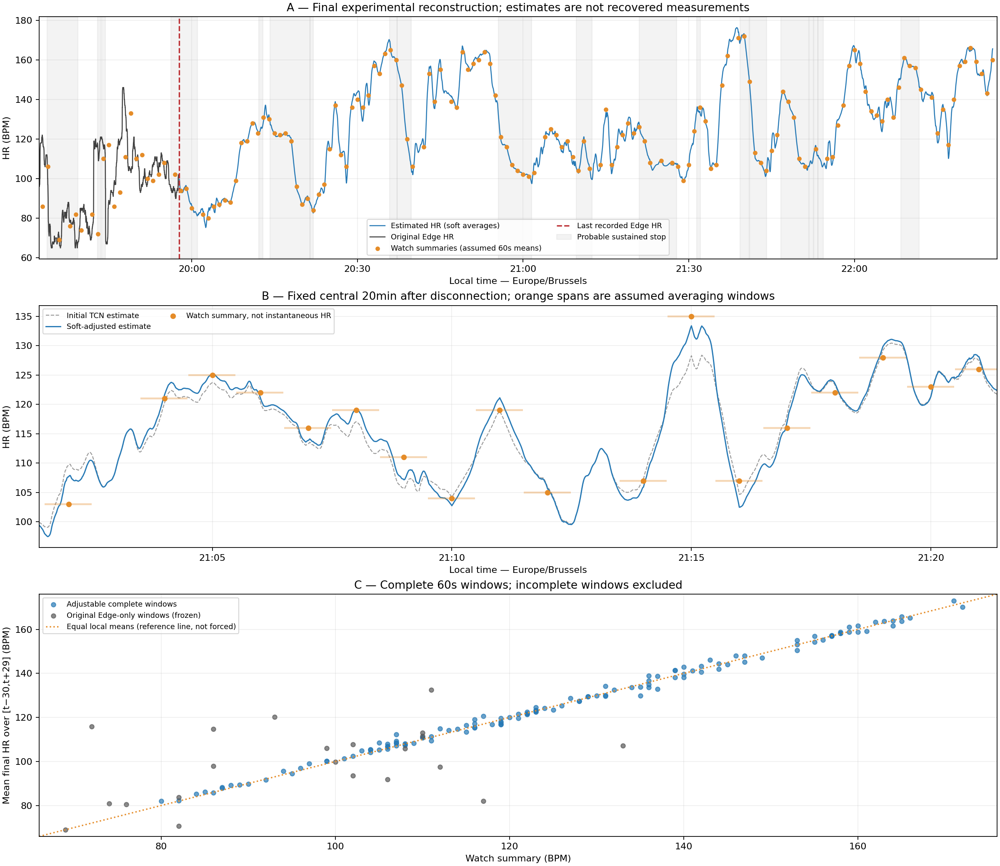
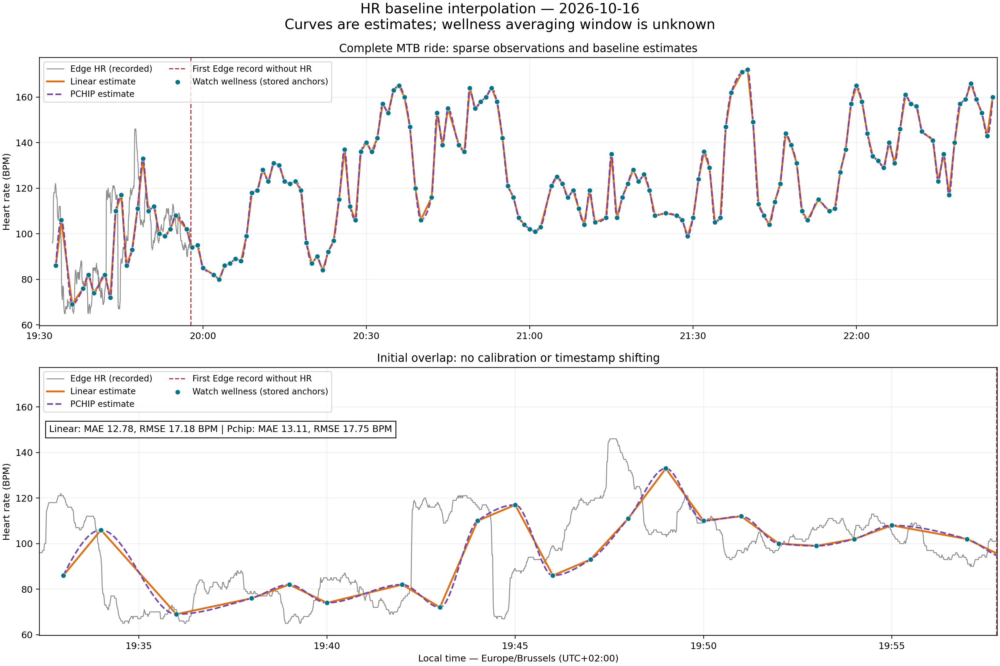
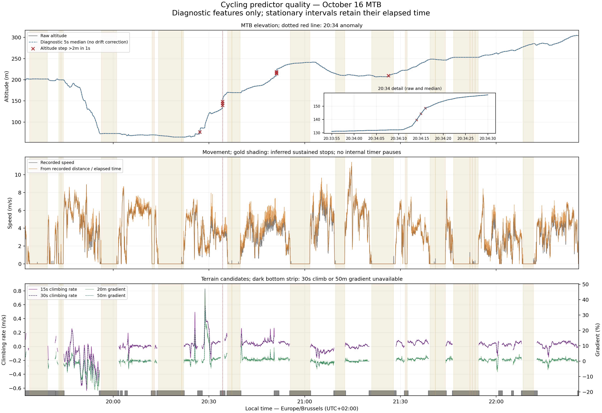

# Garmin Heart-Rate Reconstruction

Offline heart-rate estimation, from incomplete Garmin recordings to a validated FIT Activity file. During an MTB ride on October 16, 2026, a Garmin Edge 840 lost the HR signal broadcast by a Forerunner 265. Only about 25 minutes of continuous HR remained; sparse watch wellness observations covered most of the rest. This AI-directed project developed and evaluated reconstruction methods, then exported a usable activity with estimated second-by-second HR. The missing measurements remain unknown.



*Dark line: original recorded Edge HR. Orange dots: sparse FR265 wellness observations. Blue line: reconstructed HR estimates. The dashed vertical line marks the Edge HR interruption; gray bands indicate probable stops. The zoom illustrates assumed averaging windows, and the bottom panel compares reconstructed local means with watch summaries. Agreement does not establish physiological accuracy.*

## Results at a glance

| Final October 16 output | Result |
|---|---:|
| Original Edge HR preserved | 1,525 recorded seconds |
| HR estimated | 8,834 seconds |
| Supported coverage | 99.52% |
| Supported combined mean HR | 121.64 BPM |
| Supported combined maximum HR | 176.23 BPM |
| Unsupported final duration | 50 seconds, left missing |
| Deliverable | Validated FIT Activity file |

The final experimental reconstruction uses a small TensorFlow Temporal Convolutional Network (TCN), followed by soft local-average constraints from watch observations. A preservation-aware export inserts HR without changing the original route or other sensor data. The statistics above describe the supported recorded-and-estimated sequence before FIT integer rounding.

**Owner-reported practical outcome:** after importing the corrected activity, Strava Relative Effort changed from **12 to 51**, and Garmin training status was updated. These platform outcomes were reported by the project owner; repository checks did not independently reproduce the imports or platform calculations. They do not establish exact physiological accuracy.

[Original problem](#the-original-problem) · [Development journey](#development-journey) · [Evaluation](#model-evaluation-and-evidence) · [Final method](#final-reconstruction-method) · [FIT export](#fit-export-and-practical-outcome) · [Getting started](#getting-started) · [AI-directed development](#ai-directed-development)

## The original problem

The Edge 840 recorded the ride's route, speed, distance and elevation, while the Forerunner 265 broadcast HR. An unexpected broadcast interruption removed HR from most of the activity, limiting subsequent effort analysis. The watch still stored sparse wellness HR observations, but those summaries were not a continuous activity recording.


*Before reconstruction: orange points show the dense initial Edge measurements; blue points show stored watch wellness observations before, during and after the ride. The lower panel shows their sampling intervals. These are recorded observations, with no reconstructed continuous signal. Their sparse spacing explains both the opportunity and the uncertainty.*

The target was a useful, explicitly estimated HR trajectory and a valid activity export—not the recovery of a lost ground-truth signal. All original recordings were retained.

## Development journey

### 1. Recover and inspect the observations

Garmin FIT decoding established the UTC timeline, valid HR, recording gaps and source provenance. Visualizations use Europe/Brussels time. The ride contained 158 watch observations separated by 142 intervals of 60 seconds and 15 of 120 seconds.

An [initial wellness audit](docs/watch_wellness_hr_audit_2026-10-16.md) and a separate [October 12 recording-path diagnostic](docs/watch_anchor_diagnostic_2026-10-12.md) examined timestamps, sensor disagreement and possible averaging. Neither established Garmin's exact wellness filtering or averaging mechanism. Stored summaries therefore could not safely be equated with instantaneous HR.

### 2. Establish interpolation baselines

Linear and shape-preserving PCHIP interpolation supplied simple offline estimates between watch observations. Both could use observations on either side, with no extrapolation and a maximum supported anchor gap of 180 seconds. They represented broad changes but could miss short peaks and rapid recovery.



*Gray is recorded Edge HR, dots are watch observations, and orange/purple curves are interpolation estimates. The initial overlap exposes disagreement that smooth curves cannot resolve. Linear was the preferred first target baseline; this did not establish a universal advantage over PCHIP.*

The [target baseline report](docs/hr_baseline_interpolation_2026-10-16.md) was followed by a [three-ride simulation](docs/hr_reconstruction_validation_3rides.md), using two road rides and one MyWhoosh ride. Artificial sparse sampling tested point observations and complete centered averages at fixed sampling phases. Better performance on the virtual ride demonstrated why recording paths and riding conditions needed separate treatment.

### 3. Audit speed, terrain, stops and restarts

Speed alone is a weak effort proxy during coasting, technical riding and waiting. The [predictor audit](docs/cycling_predictor_quality.md) identified 20 probable sustained stops totaling 56 minutes 21 seconds, plus suspicious altitude jumps and drift. These were inferred stops, not verified ravito labels.



*Recorded altitude and speed are shown alongside derived diagnostic trends and gradients. Shading marks inferred stops; the bottom strip marks unavailable terrain features. This is a data-quality diagnostic, not an HR prediction. It shows why terrain support and stationary time require explicit masks.*

The [Strava elevation comparison](docs/strava_vs_garmin_elevation_2026-10-16.md) verified a genuinely different, timestamp-aligned exported profile. It reduced the known 20:34 altitude rise from 13.4 m to 0.6 m over the same recorded movement and improved route closure. Some local gradients and stationary sections remained questionable. Quality-masked Strava climbing features became provisional target inputs; smoother or larger elevation gain was never treated as proof of accuracy.

### 4. Test a physiological response model

A [first-order HR response model](docs/hr_physiological_feasibility.md) tested equilibrium HR driven by movement and climbing, with delayed HR dynamics. Terrain helped on the road holdouts, but transfer to the target MTB overlap was substantially worse than interpolation. A poorly identified stopped equilibrium exposed inadequate stationary training evidence.

This negative result helped separate plausible physiological equations from supported predictions. Without measured target power or cadence, speed and gradient could not identify actual pedaling effort reliably.

### 5. Learn residual corrections with gradient boosting

[Gradient-boosted residual learning](docs/hr_ml_residual_evaluation.md) predicted corrections to the linear baseline using sparse-anchor context, movement and quality-masked terrain. HistGradientBoostingRegressor improved the road validation results; adding [temporal-window features](docs/hr_ml_window_evaluation.md) improved them further.

The project then tested [virtual-ride augmentation](docs/hr_virtual_augmentation.md), which did not justify replacing the outdoor model, and [MTB-only versus mixed training](docs/hr_mtb_training_comparison.md), which favored mixed road/MTB training. Expanding to five road rides and two MTB rides established the [seven-ride Window v2 benchmark](docs/hr_seven_ride_window_benchmark.md), using 50 temporal/context features. Extra data did not improve every metric on every ride.


*Top: original Edge/watch observations and the earlier gradient-boosting estimate, with probable stops shaded. Bottom: point-anchor MTB holdout errors; bars are phase means and whiskers are phase ranges, not confidence intervals. This historical candidate is separate from the final TCN export shown first.*

### 6. Investigate sequence-to-sequence TCNs

A TCN was investigated to learn temporal patterns directly rather than summarize each window into tree features. TensorFlow/Keras fits ran locally with verified GPU operations on an RTX 3080 Laptop GPU. The [original 256→32 TCN](docs/hr_tcn_tensorflow_evaluation.md) and a [local 64→16 TCN](docs/hr_tcn_local_evaluation.md) did not displace gradient boosting. The local experiment introduced a combined Huber and 10-second temporal-change loss; architecture and loss changed together, so their effects were not isolated.

A controlled [128→16 search](docs/hr_tcn_128_search_results.md) completed 16 scheduled configurations within a fixed budget. Trial 10 had the lowest selection MAE on MTB ride 2, with a very small margin over the runner-up. A fresh fit then provided an [additional MTB ride 1 check](docs/hr_tcn_trial10_validation.md).


*Bars summarize prediction errors against recorded MTB ride 2 HR after simulated sparse sampling. Dashed lines are saved historical scores; scatter panels expose complexity and false-peak tradeoffs. These are tuning results on one activity, not independent evidence that the selected TCN generalizes better.*

### 7. Revisit what a watch observation means

Discrepancies between Edge HR and the watch dots persisted. Earlier experiments used the dots as pseudo-point constraints; the final experiment instead **assumed approximate centered 60-second averages**, without claiming this is Garmin's verified mechanism.

Trial 10 supplied the architecture for one fresh seven-ride fit under that assumption. Exact dot overwrites and the earlier anchor taper were removed. A conservative soft adjustment encouraged local mean agreement while fixing real Edge HR. This changed the observation model as well as training and postprocessing; it was a separate final experiment, not a demonstrated accuracy promotion over Window v2.

### 8. Preserve the activity while exporting HR

The official Garmin encoder initially failed on proprietary message 140 and could not faithfully retain all unknown fields. That failed approach was stopped rather than silently discarding content. A later preservation-aware approach succeeded: first prove an unchanged round-trip, then edit existing HR slots, validate every difference and independently decode the saved FIT. The [latest FIT report](docs/hr_fit_preserve_export_validation.md) supersedes the earlier export-blocked status.

## Model evaluation and evidence

The most comparable MTB results use point-anchor simulations with phases 0/20/40 seconds, the same supported hidden timestamps and no anchor-time scoring. Each trained model excludes the evaluated MTB ride. Values below are **phase-mean MAE / RMSE in BPM**; lower is better.

| Model family | MTB ride 1 | MTB ride 2 | Interpretation |
|---|---:|---:|---|
| Linear interpolation | 4.345 / 6.655 | 4.459 / 6.127 | Fixed baseline |
| Gradient boosting, initial ML-B | — | — | Earlier road-only evaluation; different evidence set |
| Window-enhanced gradient boosting, seven rides | **4.147 / 6.344** | 4.405 / 6.018 | Principal general benchmark |
| Original TCN, 256→32 | 4.241 / 6.474 | 4.546 / 6.190 | Did not beat the benchmark |
| Local TCN, 64→16 | 4.525 / 6.932 | 4.527 / 6.168 | Local geometry/loss change was insufficient |
| Tuned TCN, trial 10, 128→16 | 4.240 / 6.491 | **4.317 / 5.895** | MTB 2 used for selection |

Trial 10's MTB ride 2 score is tuning performance. MTB ride 1 had also been examined during earlier development; its later exclusion from fitting makes this an additional ride-level check, not a completely untouched test. Bold scores identify lower errors within this table, not statistically established winners.

The initial ML-B's road holdouts were 3.77/5.52 and 3.64/5.37 BPM; the first temporal-window extension achieved 3.50/5.14 and 3.34/4.97 under that road protocol. Those scores are not substitutes for the missing MTB entries. Sources: [road/window comparison](docs/hr_ml_window_evaluation.md), [seven-ride metrics](data/processed/hr_seven_ride_window_metrics.csv), [original TCN metrics](data/processed/hr_tcn_tensorflow_metrics.csv), [local TCN metrics](data/processed/hr_tcn_local_metrics.csv) and [trial-10 validation metrics](data/processed/hr_tcn_trial10_validation_metrics.csv).

**Gradient boosting remained the stronger general benchmark across the two MTB evaluations.** Trial 10 improved the selected MTB 2 result but did not beat gradient boosting on MTB 1. Its MTB 1 recovery/stationary MAE was 4.676/3.582 BPM versus 4.526/3.464 for gradient boosting; lower visual roughness did not demonstrate better dynamic accuracy. Peak amplitude, timing, unmatched peaks and restart errors are retained in the detailed reports.

The October 16 initial Edge overlap is a separate, previously examined diagnostic. The final average-trained TCN scored MAE/RMSE **12.594/16.729 BPM** over 1,487 timestamps with Edge HR withheld from predictors. The earlier seven-ride benchmark scored **12.443/16.539 BPM** on 1,420 timestamps under its hard-anchor protocol. Different masks and observation assumptions prevent a controlled head-to-head claim.

Only two MTB reference rides supplied ride-level holdout evidence; sampling phases and one-second records are correlated. Averaged-anchor sensitivity is reported separately. The final soft-average reconstruction has **no new independent held-out evaluation** and is not proven scientifically superior to the benchmark.

## Final reconstruction method

The final model learns `reference HR − linear baseline HR` on five outdoor road rides and two MTB rides. MyWhoosh and the October 16 target are excluded from training.

| Component | Final configuration |
|---|---|
| Input / output | 128 consecutive seconds / central 16 HR residuals |
| Features | 28 aligned channels: sparse HR context, baseline, speed, movement, stop/restart evidence, quality-masked climbing and validity indicators |
| Network | Non-causal residual Conv1D blocks; 16 hidden channels, kernel 3, dilations 1/2/4/8 |
| Receptive field / parameters | 61 seconds / 6,753 |
| Training | Adam, learning rate 0.0003; batch 64; 30 epochs; seed 265 |
| Loss | Masked Huber, delta 5 BPM, plus 0.5 × MAE of 10-second HR changes |
| Inference | Stride 8; average overlapping central outputs; centered five-sample residual mean within support |

Normalization uses training rides only. Hidden high-frequency target HR never enters predictors. Windows respect recording blocks; missing terrain has validity indicators. Predictions neither bridge unsupported gaps nor extrapolate beyond observation support, and the 180-second maximum anchor-gap rule remains.

Under the explicit averaging assumption, a watch value at time *t* constrains the approximate mean over *t−30* through *t+29* seconds. The blue curve can therefore rise above or fall below an orange dot at its timestamp. As the opening zoom shows, agreement concerns the surrounding minute, not an exact intersection with the dot.

The soft adjustment balances fidelity to the TCN, local-average agreement and smooth changes. Original recorded Edge HR is fixed; incompatible watch summaries cannot overwrite it. On adjustable complete windows, final local-mean MAE against watch summaries was **1.205 BPM**. This measures consistency with an assumed observation definition, not error against missing ground truth. All 158 watch values remain separately available, and the final 50 unsupported seconds remain missing.

The [final technical report](docs/hr_final_soft_average_reconstruction.md) documents the objective, masks, solver checks, observation disagreements and full-precision results. Its export-blocked passages describe the earlier stage; the [subsequent FIT validation report](docs/hr_fit_preserve_export_validation.md) records the successful export.

## FIT export and practical outcome

The completed export uses **fit-tool 0.9.16 in PRESERVE mode**, with explicit handling of existing split HR fields missing from its bundled profile. No original FIT was overwritten.

- The unchanged decode/encode round-trip was byte-identical before editing.
- Original message counts, order, definitions, timestamps and route were retained.
- All 1,525 recorded Edge HR values were preserved; 8,834 estimates were inserted into existing invalid HR slots. Unsupported HR stayed missing.
- Every non-HR byte, including proprietary message 140 and unknown fields, remained unchanged.
- Independent Garmin SDK decoding, header/file CRC checks and on-disk read-back passed.

HR was rounded to integer BPM for FIT. Compatible HR summaries were updated, including session/lap average **122 BPM** and maximum **176 BPM**, split summaries and time-in-HR-zone arrays. Calories, training effect/load, HRV and proprietary physiological metrics were retained, not recalculated from estimated HR. The [validation report](docs/hr_fit_preserve_export_validation.md) defines the summary calculations and their limits.

File integrity and platform behavior are separate checks. The validated output was suitable for a manual import test; the owner subsequently reported the successful platform use described above. The repository did not perform the uploads or independently verify the Relative Effort/training-status calculations.

The personal FIT export, full-precision final CSV, model and provenance audit are local artifacts under ignored paths. They are not public download links. An imported reconstructed activity should still be understood as containing estimates.

## Getting started

### Environments and private inputs

Start with the saved figures and reports; they require no model execution. This is a documented case study, not a one-command reproduction package with public training data.

The CPU analysis environment is the local Windows `.venv` (currently Python 3.8.8), using [requirements.txt](requirements.txt): Garmin FIT SDK 21.218.0, NumPy, pandas, Matplotlib, SciPy, pytz and scikit-learn 1.1.3. For a separately prepared CPU environment, install those requirements with that environment's `python -m pip install -r requirements.txt`.

Neural experiments used the existing Conda **`deep`** environment: Python **3.9.7**, TensorFlow **2.6.1**, Keras **2.6.0**, and verified CUDA execution on the **RTX 3080 Laptop GPU**. TensorFlow/CUDA are not provisioned by `requirements.txt`; do not install these CPU requirements indiscriminately into an existing GPU environment. Training scripts enforce a TensorFlow GPU check. Interpolation, saved-metric analysis and FIT export do not require GPU training. Some neural scripts load the official pure-Python FIT SDK from the local `.venv` if it is absent from `deep`.

Source FIT/GPX files are personal, Git-ignored inputs and are not supplied in a fresh public clone. Full reconstruction needs the original `data/mtb_edge.fit`, watch wellness source/extracted observations, aligned `data/VTT_Apero.gpx`, and—if training—the five `road_ride_1.fit` through `road_ride_5.fit` and two `mtb_ride_1.fit`/`mtb_ride_2.fit` references. The final model and normalization metadata under `results/final/` are also ignored. A fresh clone cannot reproduce the final candidate without those assets and a compatible environment.

### Inspect, regenerate analysis, or retrain

From the repository root, inspect saved search results without TensorFlow, training or output changes:

```powershell
conda run --no-capture-output -n deep python scripts/analyze_hr_tcn_128_search.py --dry-run
```

With the CPU dependencies, original Edge FIT and extracted `data/processed/watch_hr_ride_2026-10-16.csv` present, this regenerates the **historical interpolation** CSV, figure and report without ML training:

```powershell
.\.venv\Scripts\python.exe scripts/reconstruct_hr_baseline.py
```

Neither command retrains the final TCN. Viewing the final figure requires no regeneration. [Neural training](scripts/evaluate_hr_tcn_tensorflow.py), [trial validation](scripts/validate_hr_tcn_trial10.py) and [final reconstruction](scripts/reconstruct_hr_soft_average.py) are separate, guarded experiments; their reports document stage-specific commands. The final reconstruction script still includes the historical pre-export gate and refuses to run while the completed FIT exists, even with `--reuse-trained`. It should not be treated as an unrestricted final-figure refresh command.

The separate [FIT exporter](scripts/export_reconstructed_hr_fit.py) consumes the completed CSV without training. Its command and checks are in the [export report](docs/hr_fit_preserve_export_validation.md); it refuses to overwrite an existing final FIT. It loads a hash-verified fit-tool source archive into ignored `results/final/fit_tool_vendor/`, downloading the pinned source if absent rather than changing the Conda environment.

### Repository map

```text
scripts/         FIT inspection, preprocessing, evaluation, reconstruction, export
data/            Private source recordings (ignored)
data/processed/  Derived observations, metrics and candidate CSVs; some local models
docs/            Technical reports and experiment decisions
docs/images/     Existing scientific figures
results/         Search records; ignored final model, normalization, FIT and audit
requirements.txt CPU analysis dependencies
```

The final CSV is local at `data/processed/hr_tcn_soft_average_2026-10-16.csv`; the final FIT is local at `results/final/hr_reconstructed_2026-10-16.fit`. The public-facing figure is `docs/images/hr_tcn_soft_average_2026-10-16.png`. Principal entry points are the [seven-ride evaluator](scripts/evaluate_hr_seven_ride_window.py), [TCN search](scripts/search_hr_tcn_128.py), [final reconstruction report](docs/hr_final_soft_average_reconstruction.md) and [FIT validation report](docs/hr_fit_preserve_export_validation.md). Earlier reports retain their historical decisions; the final status here follows the later validated export.

## AI-Directed Development

This project was developed through an AI-directed software engineering workflow using OpenAI Codex. Codex generated the implementation code, analysis scripts, figures and documentation from iterative technical specifications, and performed the relevant local execution and verification tasks.

The project owner defined the real-world problem, requirements, constraints and acceptance criteria; reviewed and interpreted experimental outputs; selected modelling directions; and guided successive iterations. This is a disclosure of AI-generated implementation, not a claim that the owner personally hand-wrote or independently audited every line.

The workflow relied on engineering judgment: keeping comparisons fair, recognizing leakage risks, distinguishing tuning from validation, rejecting unsuccessful experiments and requiring evidence before accepting outputs. Automated checks and review of results provide bounded evidence; they do not amount to an independent line-by-line audit or prove scientific correctness beyond the documented checks.

## Limitations and lessons learned

- **Observation uncertainty:** Garmin's exact wellness averaging, filtering and latency remain unknown. Sparse summaries cannot determine every intervening HR fluctuation.
- **Reference uncertainty:** sensor disagreement, held readings and artifacts remain in recorded HR. One-second FIT records are not necessarily independent physiological measurements.
- **Limited validation:** only two MTB reference rides supplied ride-level checks; both were involved in development, and MTB 2 selected the tuned TCN. No new independent validation established the final soft-average method's superiority.
- **Uncertain effort and peaks:** target power/cadence were unavailable. Terrain and speed do not reveal pedaling effort, and reconstructed instantaneous peak height/timing is uncertain.
- **Bounded implementation assurance:** AI-generated code was exercised through documented checks, not exhaustively or independently audited. FIT integrity does not validate physiology or every downstream platform metric.

The completed project produced a useful, validated corrected activity from incomplete data while keeping observations, estimates and uncertainties explicit. Its broader lesson is that effective AI-assisted development depends on testable specifications, critical interpretation and evidence-based decisions.
