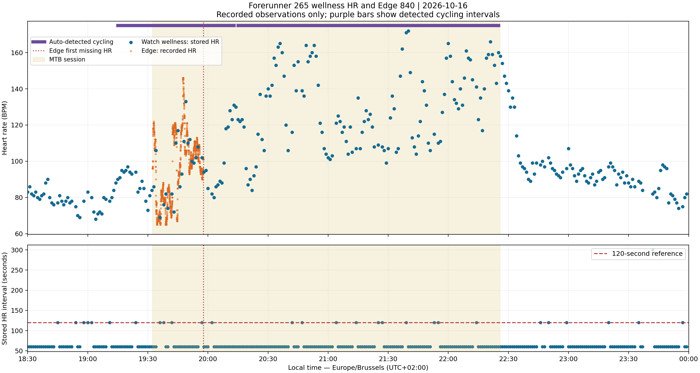
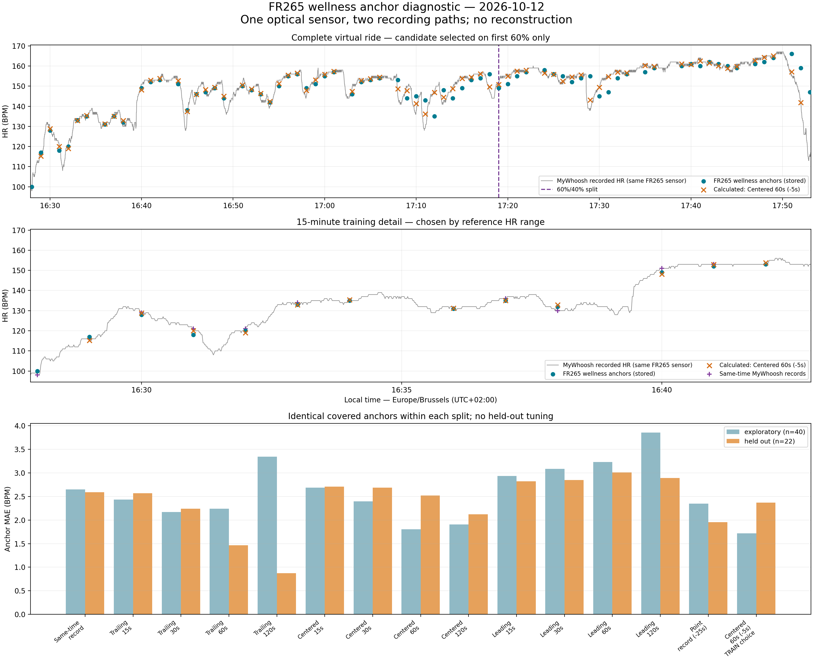

# VTT Apéro

## Initial state: Heart-rate data before reconstruction

During the MTB ride on October 16, 2026, the Garmin Edge 840 lost the
heart-rate broadcast from a Forerunner 265. The Edge activity consequently
contains only a short initial period of heart-rate measurements. The watch's
wellness FIT file provides additional sparse HR observations for the remainder
of the ride. These recorded observations serve as inputs for estimating the
missing heart-rate sequence.



*Available watch HR observations before reconstruction, alongside the initial
Edge HR measurements. The lower panel shows intervals between stored watch
observations. The points are recorded data, not a reconstructed continuous
signal.*

## Baseline interpolation

The first baseline compares linear and PCHIP estimates built only from the
recorded watch anchors, using the initial Edge HR measurements for evaluation.
No extrapolation is performed, and gaps longer than 180 seconds remain missing.

Using the project virtual environment:

```powershell
.\.venv\Scripts\python.exe -m pip install -r requirements-audit.txt
.\.venv\Scripts\python.exe scripts/reconstruct_hr_baseline.py
```

See the [baseline report](docs/hr_baseline_interpolation_2026-10-16.md) for
validation results and limitations, and the
[comparison figure](docs/images/hr_baseline_interpolation_2026-10-16.png).
The one-second output contains estimates, not additional measured HR samples.

## Wellness anchor diagnostic

The [October 12 diagnostic](docs/watch_anchor_diagnostic_2026-10-12.md)
compares FR265 wellness anchors with MyWhoosh's Bluetooth recording from the
same optical HR sensor. It tests averaging windows and modest time offsets,
with chronological candidate selection and held-out evaluation. This is a
diagnostic of recording paths, not a new reconstruction.

```powershell
.\.venv\Scripts\python.exe scripts/diagnose_watch_anchors.py
```



## Predictor quality and stops

Run the four-activity speed, terrain and stationary-period diagnostic:

```powershell
.\.venv\Scripts\python.exe scripts/audit_cycling_predictors.py
```

See the [predictor-quality report](docs/cycling_predictor_quality.md) for
candidate MTB stops, feature coverage and limitations. This audit does not
estimate heart rate.
