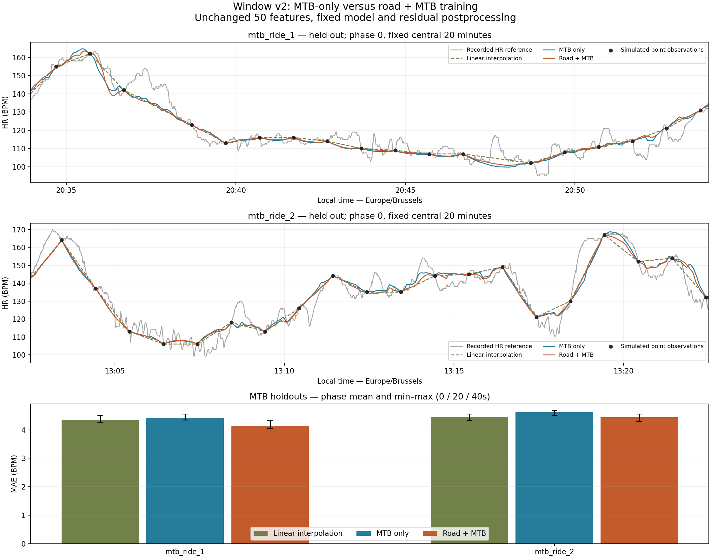

# MTB-only versus mixed training for Window v2

**Recommendation: B. Combined road + MTB training.** No automatic replacement; both new files are unapproved candidates.

## Design and reference quality

Exactly six HGB fits: two leave-one-MTB-out folds for each configuration, followed by final A on both MTBs and final B on road_ride_1 + road_ride_2 + both MTBs. No road holdouts, other road files, virtual data, search, weighting, balancing or extra refits. A and B share all settings and examples from their common training rides. Only training membership changes.

| MTB reference | Local HR start/end | Span min | Valid HR / elapsed % | Gaps / longest continuous s | Speed/distance/altitude valid | Stationary / probable-stop rows | Altitude steps >2m | Other sensors |
|---|---|---|---|---|---|---|---|---|
| mtb_ride_1 | 2025-10-10T19:07:42+02:00 / 2025-10-10T22:20:12+02:00 | 192.50 | 11551 / 100.00 | 0 / 11551 | 11550/11551/11551 | 4401/2855 | 0 | temperature |
| mtb_ride_2 | 2025-12-27T09:37:26+01:00 / 2025-12-27T16:47:36+01:00 | 430.17 | 25811 / 100.00 | 0 / 25811 | 25797/25811/25811 | 9929/6135 | 5 | temperature |

Both FITs pass integrity/decoding, unique timezone-aware UTC timestamps and HR validity. Both supply uninterrupted 1Hz references, including stationary intervals. MTB 1 records Edge 840 + OHR metadata; MTB 2 records Edge 840 + HRM 200. This difference in reference sensors can confound transfer; neither is independent physiological ground truth. Temperature is available; power/cadence are absent. No new sensor enters prediction. The first ride has one absent speed value and the second has fourteen, left missing.

Reuse `prepare`, native elevation, stop classification and `source_features`; no separate elevation investigation. Existing quality masks exclude unsupported centered climbing rates at stops, restarts, recording gaps and altitude jumps. MTB 2's five >2m adjacent altitude steps justify retaining masks; no steps exceed this threshold in MTB 1, which does not prove its altitude is accurate. Target MTB uses the existing aligned Strava terrain. Display Europe/Brussels; all computations UTC.

## Fixed model and sampling

Exactly the current 50 ordered predictors: 20 anchor/movement/terrain plus 30 temporal summaries. Regions [-60,-30), [-30,0), [0,30), [30,60); missing means remain NaN with explicit coverage. Existing speed/centered terrain preprocessing retains its own support. Future non-HR features are permitted offline; no hidden HR, ride ID, power/cadence or coordinates enter predictors. Keep linear residual targets, five-sample residual smoothing, 4f(1−f) taper and missing-feature handling. Fixed HGB parameters: `{'learning_rate': 0.05, 'max_iter': 120, 'max_leaf_nodes': 7, 'max_depth': 3, 'min_samples_leaf': 100, 'l2_regularization': 10.0, 'early_stopping': False, 'random_state': 265}`.

Replay the October 16 watch's actual ordered 142×60s + 15×120s intervals (158 observations over 172 minutes), cyclically extending or truncating by elapsed UTC time at phases 0/20/40s. Point anchors equal the exact recorded HR. Average anchors require all 60 samples [t−30,t+29]; this is a sensitivity assumption, not verified Garmin behavior. Train on point anchors only, with the same deterministic five-second timestamp selection and cyclic phase assignment, excluding that phase's anchors. No repeated targets. Maximum interpolation gap 180s, no extrapolation, no anchors from missing HR.

| Activity | Eligible training rows | Missing feature cells % | All record windows complete % | All terrain windows complete % | Current terrain valid % |
|---|---|---|---|---|---|
| mtb_ride_1 | 1779 | 16.03 | 99.44 | 27.43 | 48.29 |
| mtb_ride_2 | 3975 | 18.01 | 99.75 | 24.10 | 39.22 |
| road_ride_1 | 2509 | 3.25 | 94.38 | 90.55 | 99.36 |
| road_ride_2 | 2131 | 3.30 | 94.09 | 89.30 | 99.72 |

| Activity | Phase s | Point anchors | Average anchors |
|---|---|---|---|
| mtb_ride_1 | 0 | 175 | 174 |
| mtb_ride_1 | 20 | 175 | 173 |
| mtb_ride_1 | 40 | 174 | 174 |
| mtb_ride_2 | 0 | 394 | 392 |
| mtb_ride_2 | 20 | 393 | 392 |
| mtb_ride_2 | 40 | 393 | 393 |
| road_ride_1 | 0 | 271 | 253 |
| road_ride_1 | 20 | 270 | 256 |
| road_ride_1 | 40 | 272 | 253 |
| road_ride_2 | 0 | 237 | 217 |
| road_ride_2 | 20 | 236 | 221 |
| road_ride_2 | 40 | 239 | 220 |

| Config | Training partition | Total examples | Road % |
|---|---|---|---|
| A | mtb_ride_2 | 3975 | 0.00 |
| B | road_ride_1+road_ride_2+mtb_ride_2 | 8615 | 53.86 |
| A | mtb_ride_1 | 1779 | 0.00 |
| B | road_ride_1+road_ride_2+mtb_ride_1 | 6419 | 72.29 |
| A | mtb_ride_1+mtb_ride_2 | 5754 | 0.00 |
| B | road_ride_1+road_ride_2+mtb_ride_1+mtb_ride_2 | 10394 | 44.64 |

Coverage above is on selected training examples, not all elapsed seconds. A complete terrain window requires every rate in all four regions. Stop-related missing terrain remains missing; it is not fabricated as flat terrain. Larger rides contribute more under the unchanged unweighted policy; the road proportions above quantify this rather than silently balancing activities.

## Held-out MTB results

linear is a fixed interpolation reference, not a third fitted training experiment. Within each ride/phase all three methods AND both anchor conditions score exactly the same hidden timestamps, excluding anchors in either condition. Coverage denominator is all valid HR; `supported_n` in the CSV additionally describes each full curve before common-mask scoring. Bias equals mean-HR error on matching timestamps. Independent units are two rides, not seconds or phases.

| Held out | Anchors | Phase | Linear MAE/RMSE | A MAE/RMSE | B MAE/RMSE | A/B bias | Common n (%) |
|---|---|---|---|---|---|---|---|
| mtb_ride_1 | averaged | 0 | 4.185/5.882 | 4.168/5.939 | 3.888/5.488 | -0.286/-0.404 | 11287 (97.71%) |
| mtb_ride_1 | averaged | 20 | 4.117/5.842 | 4.160/5.931 | 3.840/5.459 | -0.374/-0.489 | 11228 (97.20%) |
| mtb_ride_1 | averaged | 40 | 4.152/5.884 | 4.156/5.924 | 3.903/5.583 | -0.499/-0.582 | 11287 (97.71%) |
| mtb_ride_1 | point | 0 | 4.275/6.563 | 4.355/6.573 | 4.074/6.162 | -0.019/-0.132 | 11287 (97.71%) |
| mtb_ride_1 | point | 20 | 4.262/6.483 | 4.342/6.524 | 4.041/6.119 | -0.543/-0.673 | 11228 (97.20%) |
| mtb_ride_1 | point | 40 | 4.498/6.919 | 4.551/6.943 | 4.323/6.693 | -0.482/-0.580 | 11287 (97.71%) |
| mtb_ride_2 | averaged | 0 | 4.101/5.407 | 4.341/5.682 | 4.160/5.455 | +1.057/+0.401 | 25289 (97.98%) |
| mtb_ride_2 | averaged | 20 | 4.068/5.408 | 4.278/5.689 | 4.128/5.449 | +1.113/+0.485 | 25289 (97.98%) |
| mtb_ride_2 | averaged | 40 | 4.109/5.570 | 4.301/5.822 | 4.093/5.486 | +1.195/+0.547 | 25348 (98.21%) |
| mtb_ride_2 | point | 0 | 4.498/6.188 | 4.675/6.381 | 4.486/6.145 | +0.820/+0.269 | 25289 (97.98%) |
| mtb_ride_2 | point | 20 | 4.551/6.182 | 4.681/6.338 | 4.555/6.164 | +1.251/+0.681 | 25289 (97.98%) |
| mtb_ride_2 | point | 40 | 4.326/6.012 | 4.504/6.249 | 4.281/5.930 | +0.924/+0.363 | 25348 (98.21%) |

| Ride | Anchors | Model | Mean MAE [range] | Mean RMSE [range] |
|---|---|---|---|---|
| mtb_ride_1 | averaged | A | 4.161 [4.156, 4.168] | 5.931 [5.924, 5.939] |
| mtb_ride_1 | averaged | B | 3.877 [3.840, 3.903] | 5.510 [5.459, 5.583] |
| mtb_ride_1 | averaged | linear | 4.151 [4.117, 4.185] | 5.870 [5.842, 5.884] |
| mtb_ride_1 | point | A | 4.416 [4.342, 4.551] | 6.680 [6.524, 6.943] |
| mtb_ride_1 | point | B | 4.146 [4.041, 4.323] | 6.324 [6.119, 6.693] |
| mtb_ride_1 | point | linear | 4.345 [4.262, 4.498] | 6.655 [6.483, 6.919] |
| mtb_ride_2 | averaged | A | 4.307 [4.278, 4.341] | 5.731 [5.682, 5.822] |
| mtb_ride_2 | averaged | B | 4.127 [4.093, 4.160] | 5.463 [5.449, 5.486] |
| mtb_ride_2 | averaged | linear | 4.093 [4.068, 4.109] | 5.462 [5.407, 5.570] |
| mtb_ride_2 | point | A | 4.620 [4.504, 4.681] | 6.323 [6.249, 6.381] |
| mtb_ride_2 | point | B | 4.441 [4.281, 4.555] | 6.080 [5.930, 6.164] |
| mtb_ride_2 | point | linear | 4.459 [4.326, 4.551] | 6.127 [6.012, 6.188] |

### Dynamics, stops and continuity

Reuse established score-only masks: high HR = reference upper decile; rise/recovery = ≥5/≤−5 BPM over 30s in a continuous reference block. Reference peaks: prominence ≥10 BPM, spacing ≥120s. Amplitude/timing use a supported ±15s local maximum; timing is bounded by that window, not unrestricted peak alignment. Unmatched predicted peaks lack a reference peak within ±30s. Roughness uses consecutive supported seconds including anchors. Stationary and ≤30s restart errors below use recorded reference HR only. CSV contains every phase/scenario metric and subset count.

| Ride | Model | High MAE | Rise/recovery MAE | Peak amp/timing | Stationary/restart MAE | Unmatched peaks mean | Step p99 mean/max | >5 BPM/s % max |
|---|---|---|---|---|---|---|---|---|
| mtb_ride_1 | A | 2.21 | 6.13/4.72 | 10.62/12.32 | 3.53/4.53 | 6.3 | 0.951/2.084 | 0.000 |
| mtb_ride_1 | B | 1.58 | 5.79/4.56 | 10.19/11.49 | 3.47/4.50 | 5.0 | 0.926/1.695 | 0.000 |
| mtb_ride_1 | linear | 1.73 | 5.88/5.10 | 10.76/15.00 | 3.50/4.66 | 6.3 | 0.683/0.817 | 0.000 |
| mtb_ride_2 | A | 4.47 | 4.78/5.83 | 7.10/10.60 | 4.22/4.77 | 21.7 | 0.972/2.254 | 0.000 |
| mtb_ride_2 | B | 4.44 | 4.87/5.37 | 7.64/11.40 | 4.28/4.73 | 17.7 | 0.844/1.735 | 0.000 |
| mtb_ride_2 | linear | 4.70 | 5.02/5.18 | 8.89/15.00 | 4.29/4.53 | 21.0 | 0.650/1.017 | 0.000 |

mtb_ride_1: adding road examples changes phase-mean MAE/RMSE by -0.270/-0.356 BPM, peak-amplitude MAE by -0.437 BPM, rise/recovery MAE by -0.340/-0.163 BPM and stationary/restart MAE by -0.059/-0.025 BPM.

mtb_ride_2: adding road examples changes phase-mean MAE/RMSE by -0.179/-0.243 BPM, peak-amplitude MAE by +0.540 BPM, rise/recovery MAE by +0.091/-0.462 BPM and stationary/restart MAE by +0.065/-0.041 BPM.

## October 16 target diagnostic and candidates

Frozen final fits use real wellness anchors and quality-masked Strava terrain. The Edge overlap diagnostic uses only its 21 actual watch anchors, never withheld Edge values. This matches the prior benchmark's overlap protocol; it is secondary and has been examined repeatedly. Synthetic point anchors do not reproduce the real watch/Edge observation mismatch.

| Model | MAE/RMSE | Bias | High MAE | Recovery MAE | Peak amp/timing | Stationary/restart MAE | Scored n (%) | Step p99/max |
|---|---|---|---|---|---|---|---|---|
| linear | 12.976/17.390 | -1.081 | 25.36 | 14.64 | 17.61/15.00 | 11.90/21.94 | 1420 (93.11%) | 0.633/0.633 |
| A | 12.544/16.649 | +0.132 | 22.67 | 14.84 | 14.72/9.80 | 11.66/21.96 | 1420 (93.11%) | 0.874/1.115 |
| B | 12.453/16.534 | -0.183 | 22.55 | 14.58 | 14.25/8.60 | 11.70/21.51 | 1420 (93.11%) | 0.925/1.607 |

Stored road-only Window v2 context: outdoor road 1 MAE/RMSE 3.50/5.14, road 2 3.34/4.97 BPM; October 16 overlap 12.499/16.667 BPM. These are different holdouts, not evidence of how that model would score on the new MTB rides; it is not refitted or scored here.

Candidate construction follows the existing recorded/estimated handoff policy: preserve every Edge observation, use the last recorded Edge value solely as the observed boundary for subsequent reconstruction, then use actual later watch anchors. This boundary is never supplied to the withheld-overlap evaluation. Preserve all 158 wellness summaries separately in `watch_hr`; within the Edge overlap they need not equal instantaneous Edge HR, so `final_hr` retains Edge priority. No unsupported trailing timestamps are filled. Future watch anchors are preserved exactly.

| Candidate | Supported n | Coverage % | Mean HR | Max HR | Estimated step p99/max | Full-series max step | Unsupported n |
|---|---|---|---|---|---|---|---|
| A | 10359 | 99.52 | 121.801 | 173.60 | 0.785/1.172 | 22.00 | 50 |
| B | 10359 | 99.52 | 121.641 | 172.58 | 0.823/1.282 | 22.00 | 50 |

On estimated seconds only, absolute A/B difference: mean 0.641, 95th percentile 2.235, maximum 7.393 BPM. Both preserve the same recorded observations and support. A different mean or smoother curve does not establish accuracy outside the measured overlap. Full-series jumps include original Edge changes; estimated-step statistics require both adjacent seconds to be estimated.

## Decision, limitations and reproduction

Conservative decision rule fixed before fitting: prefer a configuration only if it improves over linear on both rides and has nonworsening mean point MAE/RMSE versus the other configuration on both rides. Allow at most +0.5 BPM high/rise/recovery/stationary/restart MAE, +1 BPM peak-amplitude MAE and +2s timing. Averaged-anchor mean MAE/RMSE may worsen at most 0.1 BPM. Otherwise choose C. These are descriptive practical screens, not significance tests; settings are never tuned against them, and target overlap does not select the winner.

Only two held-out MTB rides, from different sensor paths and seasons, are available. Phases and 1Hz records are correlated; held optical values and sensor artifacts remain possible. Native training altitude and Strava target elevation have different error structures. Speed/terrain do not establish pedaling effort, especially during technical riding and stops without power/cadence. Recommendation remains exploratory, and no candidate automatically replaces Window v2 or v1.



Figure uses phase 0 and the central 20 minutes of the longest continuous reference block, selected without inspecting model errors. Bottom bars show means and phase ranges, not confidence intervals.

```powershell
.venv\Scripts\python.exe scripts/evaluate_hr_mtb_training.py
```

Outputs: this report, `docs/images/hr_mtb_training_comparison.png`, `data/processed/hr_mtb_training_metrics.csv`, `data/processed/hr_mtb_only_candidate_2026-10-16.csv`, `data/processed/hr_mixed_candidate_2026-10-16.csv`; script `scripts/evaluate_hr_mtb_training.py`.

- Both MTB FITs pass decoding/integrity and continuous-reference gate before fitting; native missing measurements remain missing.
- Reused exact window-boundary, gap, stop and missing-terrain checks; 50 ordered features unchanged, no duplicate targets, complete point/averaged anchors and <=180s gap-isolated interpolation verified.
- mtb_ride_1: held out from both fits; replacing hidden HR leaves inputs/predictions identical; shared support and exact anchors verified.
- mtb_ride_2: held out from both fits; replacing hidden HR leaves inputs/predictions identical; shared support and exact anchors verified.
- mtb_edge: held out from both fits; replacing hidden HR leaves inputs/predictions identical; shared support and exact anchors verified.
- Both candidate CSVs read back: original Edge and separate watch HR exact, future watch anchors exact, matching support, unsupported tail missing, valid numeric HR.
- SHA-256 preservation check passes for 176 pre-existing files; no prior model/report/reconstruction or raw data overwritten.
- Exactly six requested fits; no separate suite or dependencies. Actual script checks output sizes; figure readability is inspected after generation.

B. Combined road + MTB training.
