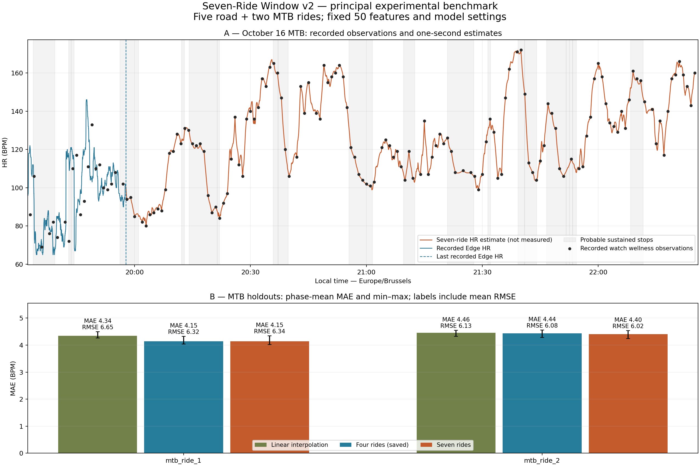

# Seven-ride Window v2 benchmark

**Principal experimental benchmark for future comparisons.** MAE and RMSE do not both improve on both held-out MTB rides.
 This status does not establish true second-by-second HR or overwrite prior reconstructions.

## Fixed experiment

Exactly three HGB fits: hold out mtb_ride_1, hold out mtb_ride_2, then all seven rides. Each holdout trains five roads plus the other MTB. No virtual activity, other fit, weighting, resampling, search or parameter change. Frozen fold models serve all phases and both observation assumptions. Four-ride results are imported from `data/processed/hr_mtb_training_metrics.csv`, model B; no previous model is refitted.

Reuse `prepare`, `window_features`, `add_windows`, `training_rows`, `examples`, `predictions`, `score` and `extra_metrics`. Exactly 50 ordered inputs (20 context/movement/terrain + 30 window summaries), four half-open regions [-60,-30), [-30,0), [0,30), [30,60). Existing speed and centered terrain preprocessing retain their underlying support. Missing feature means remain NaN; coverage stays explicit. Fixed parameters: `{'learning_rate': 0.05, 'max_iter': 120, 'max_leaf_nodes': 7, 'max_depth': 3, 'min_samples_leaf': 100, 'l2_regularization': 10.0, 'early_stopping': False, 'random_state': 265}`. Same linear residual target, centered five-sample residual mean and 4f(1−f) anchor taper.

UTC internally; Europe/Brussels for displayed dates and plots. Replay the exact October 16 pattern: 142×60s and 15×120s, 158 observations across 172min, cycling/truncating by elapsed time at phases 0/20/40s. Point anchors equal observed HR; centered averages require all 60 recorded samples [t−30,t+29]. Averaging is an alternative assumption, not established Garmin behavior. Train on point anchors only using the unchanged deterministic five-second policy and cyclic phase assignment, excluding anchors; no duplicate targets. No gap >180s interpolation or extrapolation; recording gaps split all support. Future non-HR data are permitted offline, never hidden HR.

## Input checks and training distribution

| Activity | Local start/end | Span min | HR rows / elapsed coverage % | Gaps / max spacing s | Longest block s | Speed/GPS/distance/elevation valid | Stationary rows |
|---|---|---|---|---|---|---|---|
| road_ride_1 | 2026-10-04T09:20:00+02:00 / 2026-10-04T14:49:01+02:00 | 329.02 | 17735 / 89.83 | 20 / 1219 | 2030 | 17732/17732/17735/17735 | 42 |
| road_ride_2 | 2026-09-26T09:49:36+02:00 / 2026-09-26T14:43:52+02:00 | 294.27 | 15455 / 87.53 | 22 / 1147 | 1873 | 15455/15455/15455/15455 | 36 |
| road_ride_3 | 2026-06-13T08:40:17+02:00 / 2026-06-13T14:49:01+02:00 | 368.73 | 19998 / 90.39 | 31 / 456 | 3055 | 19910/19912/19998/19998 | 59 |
| road_ride_4 | 2026-09-24T11:48:29+02:00 / 2026-09-24T14:39:03+02:00 | 170.57 | 8932 / 87.27 | 20 / 257 | 1637 | 8932/8932/8932/8932 | 38 |
| road_ride_5 | 2026-07-12T09:00:11+02:00 / 2026-07-12T16:55:00+02:00 | 474.82 | 16977 / 59.59 | 21 / 5368 | 5779 | 16937/16937/16977/16977 | 34 |
| mtb_ride_1 | 2025-10-10T19:07:42+02:00 / 2025-10-10T22:20:12+02:00 | 192.50 | 11551 / 100.00 | 0 / 1 | 11551 | 11550/11550/11551/11551 | 4401 |
| mtb_ride_2 | 2025-12-27T09:37:26+01:00 / 2025-12-27T16:47:36+01:00 | 430.17 | 25811 / 100.00 | 0 / 1 | 25811 | 25797/25797/25811/25811 | 9929 |

All seven files have distinct SHA-256 and disjoint recorded timestamps; each contributes eligible training rows. New roads 3/4/5 contain valid 1Hz HR within recorded segments. Road 5 has only about 60% elapsed coverage and an 89-minute gap; its long continuous recorded blocks remain useful, while all missing sections stay unsupported. Missing speed/GPS on roads 3/5 remain missing; no new altitude step >2m was found in these three road files. Cadence is present on roads 3/5 and temperature on all three, but neither enters the 50 predictors; no new power input. Native training elevation uses existing quality masks. Target elevation uses the existing aligned Strava GPX.

| Ride | Training rows | Point anchors 0/20/40 | Average anchors 0/20/40 | Missing feature cells % | Complete record windows % | Complete terrain windows % |
|---|---|---|---|---|---|---|
| road_ride_1 | 2509 | 271/270/272 | 253/256/253 | 3.25 | 94.38 | 90.55 |
| road_ride_2 | 2131 | 237/236/239 | 217/221/220 | 3.30 | 94.09 | 89.30 |
| road_ride_3 | 2790 | 304/302/302 | 281/280/279 | 3.89 | 94.09 | 87.38 |
| road_ride_4 | 1169 | 137/138/135 | 121/121/126 | 3.97 | 90.42 | 83.40 |
| road_ride_5 | 2432 | 253/256/253 | 240/237/239 | 3.41 | 95.60 | 91.28 |
| mtb_ride_1 | 1779 | 175/175/174 | 174/173/174 | 16.03 | 99.44 | 27.43 |
| mtb_ride_2 | 3975 | 394/393/393 | 392/392/393 | 18.01 | 99.75 | 24.10 |

| Training partition | Total rows | Road % |
|---|---|---|
| road_ride_1 + road_ride_2 + road_ride_3 + road_ride_4 + road_ride_5 + mtb_ride_2 | 15006 | 73.51 |
| road_ride_1 + road_ride_2 + road_ride_3 + road_ride_4 + road_ride_5 + mtb_ride_1 | 12810 | 86.11 |
| road_ride_1 + road_ride_2 + road_ride_3 + road_ride_4 + road_ride_5 + mtb_ride_1 + mtb_ride_2 | 16785 | 65.72 |

Proportions describe the unchanged equal-per-example policy; road dominance is not corrected by weighting. Window coverage is on selected training rows. Stops invalidate terrain support but do not erase recorded HR or valid stationary features.

## Comparable held-out results

All methods and both anchor conditions score the same hidden timestamps per ride/phase, excluding anchors in either condition. Every one of the 13 recomputed linear rows reproduces saved numeric metrics (including coverage, event counts and roughness) within 1e-10. The unmodified four-ride evaluator used the same FITs, deterministic schedule and common-mask rule, and enforced model support equal to linear. Together these establish protocol-equivalent timestamps; the old CSV did not persist timestamp hashes, so direct old-mask hash comparison is unavailable. The new executed rows persist SHA-256 of evaluated UTC timestamps for future comparisons. Saved four-ride rows are labelled `saved_four_ride`; no historical timestamps are invented.

MAE and RMSE do not both improve on both held-out MTB rides.

mtb_ride_1: seven-ride MAE/RMSE 4.147/6.344 BPM versus four-ride 4.146/6.324 (changes +0.001/+0.020).

mtb_ride_2: seven-ride MAE/RMSE 4.405/6.018 BPM versus four-ride 4.441/6.080 (changes -0.036/-0.061).

| Held out | Anchors | Phase | Linear MAE/RMSE | Four-ride saved | Seven-ride | New bias | Common n (%) |
|---|---|---|---|---|---|---|---|
| mtb_ride_1 | averaged | 0 | 4.185/5.882 | 3.888/5.488 | 3.896/5.519 | -0.615 | 11287 (97.71%) |
| mtb_ride_1 | averaged | 20 | 4.117/5.842 | 3.840/5.459 | 3.848/5.524 | -0.664 | 11228 (97.20%) |
| mtb_ride_1 | averaged | 40 | 4.152/5.884 | 3.903/5.583 | 3.950/5.660 | -0.754 | 11287 (97.71%) |
| mtb_ride_1 | point | 0 | 4.275/6.563 | 4.074/6.162 | 4.023/6.120 | -0.329 | 11287 (97.71%) |
| mtb_ride_1 | point | 20 | 4.262/6.483 | 4.041/6.119 | 4.073/6.179 | -0.848 | 11228 (97.20%) |
| mtb_ride_1 | point | 40 | 4.498/6.919 | 4.323/6.693 | 4.345/6.734 | -0.723 | 11287 (97.71%) |
| mtb_ride_2 | averaged | 0 | 4.101/5.407 | 4.160/5.455 | 4.097/5.354 | +0.234 | 25289 (97.98%) |
| mtb_ride_2 | averaged | 20 | 4.068/5.408 | 4.128/5.449 | 4.074/5.370 | +0.310 | 25289 (97.98%) |
| mtb_ride_2 | averaged | 40 | 4.109/5.570 | 4.093/5.486 | 4.053/5.436 | +0.379 | 25348 (98.21%) |
| mtb_ride_2 | point | 0 | 4.498/6.188 | 4.486/6.145 | 4.427/6.042 | +0.104 | 25289 (97.98%) |
| mtb_ride_2 | point | 20 | 4.551/6.182 | 4.555/6.164 | 4.540/6.126 | +0.517 | 25289 (97.98%) |
| mtb_ride_2 | point | 40 | 4.326/6.012 | 4.281/5.930 | 4.248/5.887 | +0.198 | 25348 (98.21%) |

| Ride | Anchors | Model | Mean MAE [phase range] | Mean RMSE [phase range] |
|---|---|---|---|---|
| mtb_ride_1 | averaged | four_ride | 3.877 [3.840, 3.903] | 5.510 [5.459, 5.583] |
| mtb_ride_1 | averaged | linear | 4.151 [4.117, 4.185] | 5.870 [5.842, 5.884] |
| mtb_ride_1 | averaged | seven_ride | 3.898 [3.848, 3.950] | 5.568 [5.519, 5.660] |
| mtb_ride_1 | point | four_ride | 4.146 [4.041, 4.323] | 6.324 [6.119, 6.693] |
| mtb_ride_1 | point | linear | 4.345 [4.262, 4.498] | 6.655 [6.483, 6.919] |
| mtb_ride_1 | point | seven_ride | 4.147 [4.023, 4.345] | 6.344 [6.120, 6.734] |
| mtb_ride_2 | averaged | four_ride | 4.127 [4.093, 4.160] | 5.463 [5.449, 5.486] |
| mtb_ride_2 | averaged | linear | 4.093 [4.068, 4.109] | 5.462 [5.407, 5.570] |
| mtb_ride_2 | averaged | seven_ride | 4.075 [4.053, 4.097] | 5.387 [5.354, 5.436] |
| mtb_ride_2 | point | four_ride | 4.441 [4.281, 4.555] | 6.080 [5.930, 6.164] |
| mtb_ride_2 | point | linear | 4.459 [4.326, 4.551] | 6.127 [6.012, 6.188] |
| mtb_ride_2 | point | seven_ride | 4.405 [4.248, 4.540] | 6.018 [5.887, 6.126] |

### High HR, peaks, recovery and stops

Established score-only definitions: high HR = reference upper decile; rise/recovery = ≥5/≤−5 BPM change over 30s within a continuous block. True peaks require ≥10 BPM prominence and ≥120s separation. Peak amplitude/timing use a fully scored ±15s local maximum; timing is bounded by this window, not unrestricted matching. Unmatched predicted peaks lack a reference peak within ±30s. Roughness includes consecutive supported anchor timestamps. Stationary and ≤30s restart errors use only recorded reference HR. CSV supplies all phase/scenario subset counts and errors; a missing event metric is NaN, never zero.

| Ride | Model | High MAE | Rise/recovery MAE | Peak amp/timing s | Stationary/restart MAE | Unmatched mean | Step p99 mean/max | >5 BPM/s % max |
|---|---|---|---|---|---|---|---|---|
| mtb_ride_1 | four_ride | 1.58 | 5.79/4.56 | 10.19/11.49 | 3.47/4.50 | 5.0 | 0.926/1.695 | 0.000 |
| mtb_ride_1 | linear | 1.73 | 5.88/5.10 | 10.76/15.00 | 3.50/4.66 | 6.3 | 0.683/0.817 | 0.000 |
| mtb_ride_1 | seven_ride | 1.50 | 5.83/4.53 | 10.28/11.50 | 3.46/4.53 | 5.3 | 0.953/2.018 | 0.000 |
| mtb_ride_2 | four_ride | 4.44 | 4.87/5.37 | 7.64/11.40 | 4.28/4.73 | 17.7 | 0.844/1.735 | 0.000 |
| mtb_ride_2 | linear | 4.70 | 5.02/5.18 | 8.89/15.00 | 4.29/4.53 | 21.0 | 0.650/1.017 | 0.000 |
| mtb_ride_2 | seven_ride | 4.44 | 4.88/5.22 | 7.95/11.75 | 4.27/4.64 | 17.3 | 0.812/1.756 | 0.000 |

mtb_ride_1: seven-minus-four high/rise/recovery MAE -0.085/+0.044/-0.032 BPM; peak amplitude/timing +0.090 BPM/+0.009s. These diagnostics must be considered alongside mean errors.

mtb_ride_2: seven-minus-four high/rise/recovery MAE +0.004/+0.000/-0.146 BPM; peak amplitude/timing +0.305 BPM/+0.355s. These diagnostics must be considered alongside mean errors.

Unavailable seven-ride metric rows: high_mae=0, rise_mae=0, recovery_mae=0, transition_mae=0, peak_amplitude_mae=0, stationary_mae=0, restart_mae=0.

## October 16 secondary overlap and reconstruction

The frozen final model uses all seven training rides. Its scored Edge overlap uses only 21 real watch observations; no withheld Edge HR is an input. The already examined overlap is not a pristine independent test and does not tune the model.

| Model | MAE/RMSE | Bias | High MAE | Recovery MAE | Peak amp/timing | Common n (%) |
|---|---|---|---|---|---|---|
| linear | 12.976/17.390 | -1.081 | 25.36 | 14.64 | 17.61/15.00 | 1420 (93.11%) |
| seven_ride | 12.443/16.539 | -0.192 | 22.63 | 14.58 | 14.17/8.80 | 1420 (93.11%) |
| four_ride | 12.453/16.534 | -0.183 | 22.55 | 14.58 | 14.25/8.60 | 1420 (93.11%) |

Candidate construction follows the prior handoff policy: preserve all original Edge HR, use its last recorded value as a boundary only for later estimates, and use subsequent real watch anchors. This known handoff value never enters the withheld-overlap diagnostic. All 158 watch summaries are preserved separately in `watch_hr`; `final_hr` retains Edge priority where both exist. Watch pseudo-point constraints may differ from instantaneous HR. No unsupported final timestamp is filled.

| Supported mean BPM | Supported max BPM | Recorded Edge seconds | Estimated seconds | Supported n (%) | Unsupported seconds | Estimated step p99/max BPM/s |
|---|---|---|---|---|---|---|
| 121.602 | 172.000 | 1525 | 8834 | 10359 (99.52%) | 50 | 0.777/1.182 |

The supported mean uses recorded and estimated values; the maximum can be an estimate and does not establish the true missing peak. No score is claimed for the unrecorded target HR. Source/quality flags distinguish Edge records, model estimates and missing support; watch observations retain their own column.

## Limitations and benchmark use

This is the new experimental benchmark to beat, regardless of whether every metric improves. Seven training rides do not create seven independent MTB validation rides: only the two held-out MTBs test transfer, and phases/seconds are correlated. MTB 1 has OHR metadata and MTB 2 an HRM 200; road recording paths, seasons and HR artifacts differ. Native training versus Strava target terrain and frequent MTB stops create domain shifts. Sparse wellness observations, unknown exact averaging/latency, uncertain short peaks, sensor errors and absent target power/cadence remain limitations. Neither this reconstruction nor a lower exploratory error proves true second-by-second physiology.



Panel A distinguishes recorded Edge/watch observations from estimates and shades probable sustained stops; the dashed marker is the last recorded Edge HR (observed disconnection boundary). Panel B uses protocol-comparable point-anchor scores. Bars show phase means, error bars the dependent phase min–max, not confidence intervals; labels include RMSE.

```powershell
.venv\Scripts\python.exe scripts/evaluate_hr_seven_ride_window.py
```

Outputs: this report, `docs/images/hr_seven_ride_window_benchmark.png`, `data/processed/hr_seven_ride_window_metrics.csv`, `data/processed/hr_seven_ride_candidate_2026-10-16.csv`; implementation `scripts/evaluate_hr_seven_ride_window.py`. README presents this as the principal experimental benchmark; historical outputs remain intact.

- All seven official FIT decodes/integrity checks pass; file hashes distinct, recorded timestamps disjoint, all references usable and all seven contribute eligible unique targets before fitting.
- Reused exact window-boundary/gap/stop/terrain checks; 50 ordered predictors unchanged; declared point and complete 60-s average anchors verified; <=180s spans remain in continuous record blocks.
- mtb_ride_1: held out entirely; hidden-HR substitution leaves features/predictions identical; exact anchors, numeric range and common timestamp support verified.
- mtb_ride_2: held out entirely; hidden-HR substitution leaves features/predictions identical; exact anchors, numeric range and common timestamp support verified.
- mtb_edge: held out entirely; hidden-HR substitution leaves features/predictions identical; exact anchors, numeric range and common timestamp support verified.
- All 13 linear comparison rows reproduce saved numeric metrics/support within 1e-10; four-ride rows imported without refitting. Executed rows store evaluated timestamp hashes.
- Candidate CSV read back: original Edge HR and all 158 separate watch observations exact, future anchors exact, UTC timeline preserved, final unsupported timestamps missing and numeric HR valid.
- SHA-256 preservation checks pass for 182 previous files; README is the only existing file intentionally updated.
- Exactly three fits with fixed random state; no repeat fit, search, new dependency or separate suite. Nonempty artifacts and README link are checked; figure readability is inspected after generation.
