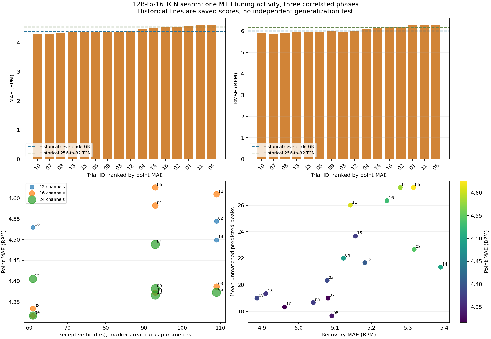

# Budget-limited 128-to-16 TCN search

Selection uses only MTB ride 2: mean postprocessed point-anchor MAE across phases 0/20/40. Five roads plus MTB 1 train each configuration; phases and seconds are correlated. This is tuning performance, not independent generalization evidence. No winner is promoted or retrained.

Completed 16/16 scheduled trials. Charged runtime 15.45/70 minutes. Stop reason: Every scheduled trial already has a terminal status.

Historical MTB-2 point phase means (saved results, unchanged evaluation hashes):

| model | mae | rmse | bias | high_mae | rise_mae | recovery_mae | peak_amplitude_mae | peak_timing_mae_s | unmatched_peaks | stationary_mae | restart_mae | step_p99 | max_step | steps_gt5_percent | supported_percent |
| --- | --- | --- | --- | --- | --- | --- | --- | --- | --- | --- | --- | --- | --- | --- | --- |
| Historical seven-ride GB | 4.405 | 6.0182 | 0.2729 | 4.4407 | 4.8753 | 5.2207 | 7.9476 | 11.7532 | 17.3333 | 4.2727 | 4.6399 | 0.8124 | 1.6278 | 0.0 | 99.8063 |
| Historical 256-to-32 TCN | 4.5463 | 6.1896 | 0.3061 | 4.4744 | 5.0453 | 5.2814 | 7.0661 | 11.3427 | 27.3333 | 4.3287 | 4.7991 | 1.0207 | 1.8806 | 0.0 | 99.8063 |

Leading completed candidate: **trial_10**, dilations 1/2/4/8, 16 channels, LR 0.0003, batch 64, RF 61s and 6753 parameters; MAE 4.3165, RMSE 5.8952 BPM.

| rank | trial_id | dilations | channels | learning_rate | batch_size | parameters | mae | rmse | recovery_mae | peak_amplitude_mae | peak_timing_mae_s | unmatched_peaks | stationary_mae |
| --- | --- | --- | --- | --- | --- | --- | --- | --- | --- | --- | --- | --- | --- |
| 1 | trial_10 | 1/2/4/8 | 16 | 0.0003 | 64 | 6753 | 4.3165 | 5.8952 | 4.9616 | 7.8973 | 12.1366 | 18.3333 | 4.1441 |
| 2 | trial_07 | 1/2/4/8 | 24 | 0.0003 | 32 | 14737 | 4.3171 | 5.8768 | 5.0808 | 6.767 | 10.7981 | 19.0 | 4.1507 |
| 3 | trial_08 | 1/2/4/8 | 16 | 0.0003 | 32 | 6753 | 4.3339 | 5.9163 | 5.0912 | 7.3513 | 10.8697 | 17.6667 | 4.2153 |
| 4 | trial_13 | 1/2/4/8/8 | 24 | 0.0003 | 32 | 18241 | 4.3664 | 5.9477 | 4.9101 | 7.3493 | 11.3377 | 19.3333 | 4.1043 |
| 5 | trial_15 | 1/2/4/8/8 | 16 | 0.0003 | 32 | 8321 | 4.3724 | 5.9775 | 5.1562 | 6.9968 | 10.7313 | 23.6667 | 4.2208 |
| 6 | trial_05 | 1/2/4/8/12 | 24 | 0.0003 | 32 | 18241 | 4.3731 | 5.963 | 5.0405 | 7.0336 | 10.8188 | 18.6667 | 4.1668 |
| 7 | trial_09 | 1/2/4/8/8 | 24 | 0.0003 | 64 | 18241 | 4.382 | 5.9898 | 4.8859 | 7.2459 | 11.0939 | 19.0 | 4.197 |
| 8 | trial_03 | 1/2/4/8/12 | 16 | 0.0003 | 64 | 8321 | 4.3869 | 5.965 | 5.0784 | 7.0527 | 10.7579 | 20.3333 | 4.2489 |
| 9 | trial_12 | 1/2/4/8 | 24 | 0.001 | 32 | 14737 | 4.4053 | 6.0101 | 5.1821 | 6.6824 | 10.5414 | 21.6667 | 4.1462 |
| 10 | trial_04 | 1/2/4/8/8 | 24 | 0.001 | 64 | 18241 | 4.4885 | 6.1111 | 5.1233 | 7.1241 | 10.7045 | 22.0 | 4.1941 |
| 11 | trial_14 | 1/2/4/8/12 | 12 | 0.0003 | 64 | 4801 | 4.4989 | 6.1392 | 5.39 | 6.9914 | 11.6869 | 21.3333 | 4.3798 |
| 12 | trial_16 | 1/2/4/8 | 12 | 0.001 | 64 | 3913 | 4.5297 | 6.1867 | 5.2427 | 6.8549 | 11.3436 | 26.3333 | 4.3543 |
| 13 | trial_02 | 1/2/4/8/12 | 12 | 0.0003 | 32 | 4801 | 4.5442 | 6.1859 | 5.3174 | 6.9664 | 11.495 | 22.6667 | 4.4525 |
| 14 | trial_01 | 1/2/4/8/8 | 16 | 0.001 | 32 | 8321 | 4.5821 | 6.2724 | 5.2795 | 6.9082 | 10.9118 | 27.3333 | 4.3746 |
| 15 | trial_11 | 1/2/4/8/12 | 16 | 0.001 | 64 | 8321 | 4.6094 | 6.2784 | 5.1422 | 6.952 | 10.4719 | 26.0 | 4.3887 |
| 16 | trial_06 | 1/2/4/8/8 | 16 | 0.001 | 64 | 8321 | 4.6257 | 6.307 | 5.3156 | 6.8072 | 10.7482 | 27.3333 | 4.5626 |

The first-to-second MAE gap is 0.0006 BPM. Below 0.1 BPM is descriptively close and inconclusive here. No significance or generalization claim follows.

The lower-MAE leader has -0.67 mean unmatched peaks versus the runner-up. This does not show a false-peak tradeoff between these two candidates.

Receptive field descriptive groups:

| receptive_field | trials | mean_mae | best_mae |
| --- | --- | --- | --- |
| 61 | 5 | 4.3805 | 4.3165 |
| 93 | 6 | 4.4695 | 4.3664 |
| 109 | 5 | 4.4825 | 4.3731 |

Channel count descriptive groups:

| channels | trials | mean_mae | best_mae |
| --- | --- | --- | --- |
| 12 | 3 | 4.5243 | 4.4989 |
| 16 | 7 | 4.461 | 4.3165 |
| 24 | 6 | 4.3887 | 4.3171 |

Leading trial versus Historical seven-ride GB: MAE difference -0.0884 BPM; unmatched peaks difference +1.00, recovery MAE difference -0.2592 BPM; peak amplitude/timing differences -0.0503 BPM / +0.38s.

Leading trial versus Historical 256-to-32 TCN: MAE difference -0.2298 BPM; unmatched peaks difference -9.00, recovery MAE difference -0.3199 BPM; peak amplitude/timing differences +0.8312 BPM / +0.79s.

RF/channel groups mix learning rates and batch sizes and contain unequal trial counts. Their means and the complexity scatter describe only completed sampled configurations; they cannot establish that larger RFs or models cause improvement. Inspect the unmatched-peak column and recovery scatter alongside the MAE ranking; lower MAE with more unmatched peaks is a visible tradeoff, not a new combined score.

Unranked trials (never assigned a validation rank):

None.

Per-phase point and averaged-anchor sensitivity metrics remain in `results/tcn_128_search/trial_metrics.csv` and each completed trial's `metrics.csv`; aggregate CSV is recoverable from those committed trial files. Leaderboard includes phase MAE min/max and averaged-anchor means. Phase spread is not a confidence interval. Histories record training losses, never the selection objective.

Only the fixed six training rides enter normalization. No MyWhoosh, October 16 fitting, final all-seven fit or additional model experiment is performed. GPU nondeterminism, sensor/reference error, uncertain wellness averaging, sparse anchors and selection optimism remain limitations. Historical comparisons provide context only. Independent validation on new activities is needed before promotion.
