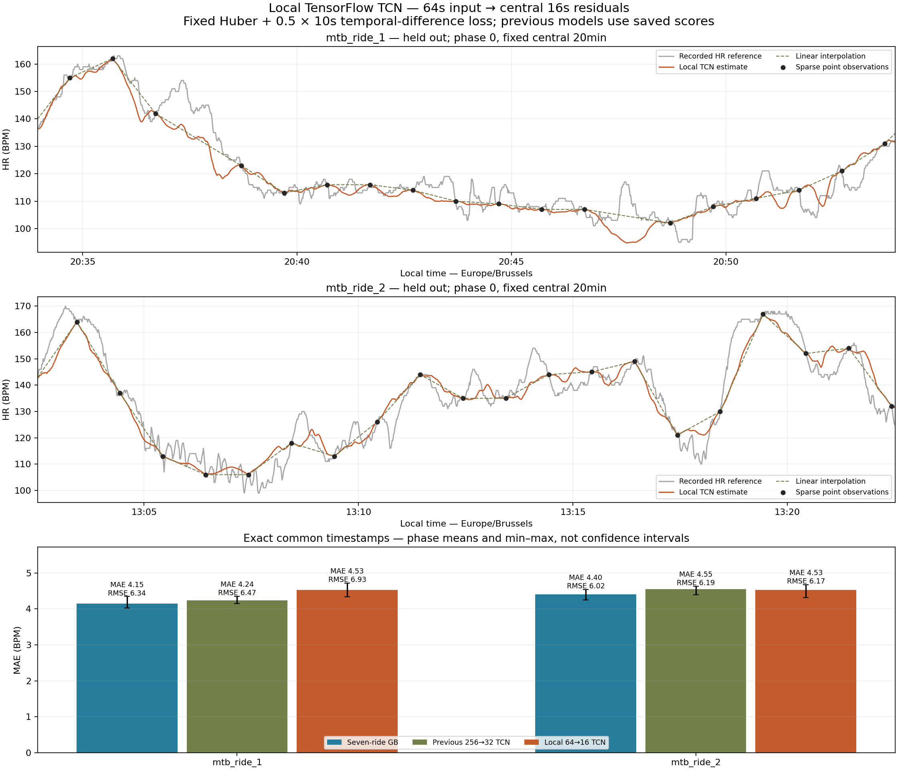
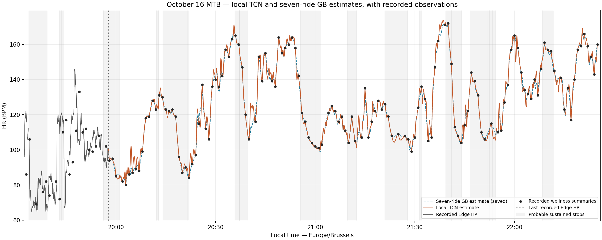

# Local TCN with temporal-difference loss

**A. Retain the existing gradient-boosting benchmark.**

Exactly three local-TCN fits: hold out MTB 1, hold out MTB 2, then all seven real rides. Previous 256→32 TCN and seven-ride gradient boosting use saved CSV metrics only. No virtual data, search, alternate seed, early stopping, previous-model refit or automatic promotion. Geometry and loss change together; this experiment cannot attribute a difference to either change in isolation.

## Architecture and environment

```json
{
  "os": "Windows-10-10.0.26300-SP0",
  "python": "3.9.7 (default, Sep 16 2021, 16:59:28) [MSC v.1916 64 bit (AMD64)]",
  "executable": "C:\\ProgramData\\Anaconda3\\envs\\deep\\python.exe",
  "tensorflow": "2.6.1",
  "keras": "2.6.0",
  "devices": [
    "PhysicalDevice(name='/physical_device:GPU:0', device_type='GPU')"
  ],
  "gpu_details": [
    {
      "device_name": "NVIDIA GeForce RTX 3080 Laptop GPU",
      "compute_capability": [
        8,
        6
      ]
    }
  ],
  "operation_device": "/job:localhost/replica:0/task:0/device:GPU:0",
  "operation_sum": 262144.0,
  "sdk": "C:\\Projects\\Py\\git\\vtt_apero\\.venv\\Lib\\site-packages\\garmin_fit_sdk\\__init__.py",
  "numpy": "1.23.5",
  "pandas": "1.3.3",
  "tf_memory_bytes": {
    "current": 17920,
    "peak": 50688
  },
  "device_memory_inventory": "NVIDIA GeForce RTX 3080 Laptop GPU, 8192 MiB, 6166 MiB"
}
```

Existing `deep` environment, unchanged TensorFlow/Keras/CUDA and pure-Python SDK loading. Actual GPU matmul and convolutions pass. GPU nondeterminism remains possible despite seed 265, deterministic-op/cuBLAS flags and float32 with TF32/mixed precision disabled; no repeated fit is used to claim training determinism.

Input (64,28); 1×1 projection to 16 channels; four residual blocks with two kernel-3, stride-1, same-padding convolutions at dilations **1,2,4,4**, ReLU and skip-add; linear 1×1 projection; crop [24:40], output (16,1). **6,753 parameters.** RF = 1+2×(3−1)×(1+2+4+4) = **45s**, radius 22. Gradient checks for every output prove RF endpoints [24+j−22,24+j+22], j=0…15: aggregate support [2,61] stays inside the 64s input, so central predictions do not depend on external convolution padding. This RF describes network features; existing anchor context and cycling preprocessing retain their own temporal support.

## Reused data pipeline and fixed loss

Reuse the previous script's 28 feature channels, raw-feature construction, training-only means/scales, sparse-anchor simulation, block discovery, padded extraction, overlap averaging, prediction postprocessing, evaluation, candidate writer and checkpoint fitting loop. Its source files stay unchanged. This script binds those helpers to local lengths and experiment-specific paths in its own process. New checkpoints also verify experiment/config identity, input/output shapes and source hashes, so the old 256→32 weights cannot be resumed accidentally.

Train on full 64 consecutive recorded seconds, stride 16. Central targets are positions 24…39, then 40…55, then 56…71: adjacent, non-overlapping segments. Each window receives exactly one cyclic phase 0/20/40 based on start/16 modulo 3, preserving the prior phase-selection convention. Point anchors only for training; point and complete centered-60s-average anchors for sensitivity evaluation. Actual October 16 ordered 142×60s+15×120s intervals are replayed by elapsed UTC time, with ≤180s support and no extrapolation. Missing HR is never synthesized. Existing terrain masks, stop/restart features and explicit feature-validity flags remain unchanged; no power/cadence or dense HR enters inputs or normalization.

Labels minimally extend [true_residual, valid_mask] to **[true_residual, valid_mask, aligned_linear_HR]**. Huber uses delta 5 BPM and divides its sum by valid target seconds, excluding unsupported/missing reference values and observed anchors. Invalid labels are finite placeholders; the loss additionally sanitizes masked NaNs. For the temporal component explicitly form actual_HR = baseline+true_residual and predicted_HR = baseline+predicted_residual, then compare their t→t+10 changes. Each 16s segment offers six pairs, with both endpoints valid/unobserved and inside the same recorded block and output window. Average absolute change error over eligible pairs; no valid pairs gives zero with finite gradients. Baseline cancels algebraically in the final difference error, but both absolute-HR trajectories are explicitly constructed from aligned labels as specified.

**Total = Huber + 0.5 × temporal**, fixed before evaluation. Huber is quadratic in BPM below delta and delta-scaled linear above it; the temporal term is MAE in BPM. Their numerical scales and fixed coefficient are empirical, not a calibrated physiological likelihood. Adam 0.001, batch 32, float32, seed 265 and 30 epochs remain unchanged. Components below are Keras epoch means of per-batch normalized components; total loss uses Keras loss aggregation, so last partial batches can produce a small aggregation difference from Huber+0.5×temporal. They are training metrics, not held-out selection criteria.

| Fit | Training rides | Windows | Loss seconds | 10s pairs | Training s | Final total | Final Huber | Final temporal |
|---|---|---|---|---|---|---|---|---|
| 1 | road_ride_1+road_ride_2+road_ride_3+road_ride_4+road_ride_5+mtb_ride_2 | 6061 | 94842 | 34836 | 43.91 | 9.6463 | 8.2643 | 2.7755 |
| 2 | road_ride_1+road_ride_2+road_ride_3+road_ride_4+road_ride_5+mtb_ride_1 | 5170 | 80812 | 29659 | 37.78 | 9.0285 | 7.6971 | 2.6421 |
| 3 | road_ride_1+road_ride_2+road_ride_3+road_ride_4+road_ride_5+mtb_ride_1+mtb_ride_2 | 6779 | 106150 | 39009 | 49.05 | 10.1345 | 8.7073 | 2.8505 |

| Fit | Source ride | Windows | Loss seconds | Pairs |
|---|---|---|---|---|
| 1 | road_ride_1 | 1017 | 15869 | 5811 |
| 1 | road_ride_2 | 865 | 13500 | 4938 |
| 1 | road_ride_3 | 1123 | 17501 | 6421 |
| 1 | road_ride_4 | 472 | 7339 | 2680 |
| 1 | road_ride_5 | 975 | 15295 | 5636 |
| 1 | mtb_ride_2 | 1609 | 25338 | 9350 |
| 2 | road_ride_1 | 1017 | 15869 | 5811 |
| 2 | road_ride_2 | 865 | 13500 | 4938 |
| 2 | road_ride_3 | 1123 | 17501 | 6421 |
| 2 | road_ride_4 | 472 | 7339 | 2680 |
| 2 | road_ride_5 | 975 | 15295 | 5636 |
| 2 | mtb_ride_1 | 718 | 11308 | 4173 |
| 3 | road_ride_1 | 1017 | 15869 | 5811 |
| 3 | road_ride_2 | 865 | 13500 | 4938 |
| 3 | road_ride_3 | 1123 | 17501 | 6421 |
| 3 | road_ride_4 | 472 | 7339 | 2680 |
| 3 | road_ride_5 | 975 | 15295 | 5636 |
| 3 | mtb_ride_1 | 718 | 11308 | 4173 |
| 3 | mtb_ride_2 | 1609 | 25338 | 9350 |

Inference uses central starts 0,8,16,… and averages overlapping 16s outputs at matching seconds inside each continuous block. Absent boundary context is zero-filled with record_valid=0 and explicit feature masks, never copied from another block. The existing centered five-sample residual mean and 4f(1−f) taper run independently within supported anchor spans; observations are restored exactly. Invalid terrain remains masked. Full prediction support equals linear support; the evaluated UTC hashes match both saved model CSVs exactly, with no coverage loss.

## Held-out MTB comparison

Individual seconds/phases are correlated; only two MTB activities are independent evaluation units. All methods use identical scored timestamps and exclude anchor times from both conditions. Historical predictions are never invented; previous models contribute their exact saved scores.

| Ride | Anchors | Phase | GB MAE/RMSE | Old TCN | Local TCN | Local bias | Common n (%) |
|---|---|---|---|---|---|---|---|
| mtb_ride_1 | averaged | 0 | 3.896/5.519 | 4.090/5.724 | 4.359/6.315 | -1.285 | 11287 (97.71%) |
| mtb_ride_1 | averaged | 20 | 3.848/5.524 | 4.112/5.857 | 4.469/6.522 | -1.475 | 11228 (97.20%) |
| mtb_ride_1 | averaged | 40 | 3.950/5.660 | 4.047/5.814 | 4.533/6.517 | -1.680 | 11287 (97.71%) |
| mtb_ride_1 | point | 0 | 4.023/6.120 | 4.149/6.248 | 4.333/6.726 | -1.044 | 11287 (97.71%) |
| mtb_ride_1 | point | 20 | 4.073/6.179 | 4.222/6.440 | 4.521/6.957 | -1.646 | 11228 (97.20%) |
| mtb_ride_1 | point | 40 | 4.345/6.734 | 4.354/6.733 | 4.722/7.112 | -1.666 | 11287 (97.71%) |
| mtb_ride_2 | averaged | 0 | 4.097/5.354 | 4.363/5.777 | 4.305/5.694 | +0.296 | 25289 (97.98%) |
| mtb_ride_2 | averaged | 20 | 4.074/5.370 | 4.274/5.638 | 4.266/5.646 | +0.288 | 25289 (97.98%) |
| mtb_ride_2 | averaged | 40 | 4.053/5.436 | 4.202/5.584 | 4.184/5.555 | +0.336 | 25348 (98.21%) |
| mtb_ride_2 | point | 0 | 4.427/6.042 | 4.621/6.342 | 4.595/6.291 | +0.180 | 25289 (97.98%) |
| mtb_ride_2 | point | 20 | 4.540/6.126 | 4.629/6.261 | 4.675/6.299 | +0.479 | 25289 (97.98%) |
| mtb_ride_2 | point | 40 | 4.248/5.887 | 4.389/5.966 | 4.311/5.913 | +0.183 | 25348 (98.21%) |

| Ride | Anchors | Model | Mean MAE [phase range] | Mean RMSE [phase range] |
|---|---|---|---|---|
| mtb_ride_1 | averaged | Previous 256→32 TCN | 4.083 [4.047,4.112] | 5.798 [5.724,5.857] |
| mtb_ride_1 | averaged | Local 64→16 TCN | 4.454 [4.359,4.533] | 6.451 [6.315,6.522] |
| mtb_ride_1 | averaged | Linear interpolation | 4.151 [4.117,4.185] | 5.870 [5.842,5.884] |
| mtb_ride_1 | averaged | Seven-ride GB | 3.898 [3.848,3.950] | 5.568 [5.519,5.660] |
| mtb_ride_1 | point | Previous 256→32 TCN | 4.241 [4.149,4.354] | 6.474 [6.248,6.733] |
| mtb_ride_1 | point | Local 64→16 TCN | 4.525 [4.333,4.722] | 6.932 [6.726,7.112] |
| mtb_ride_1 | point | Linear interpolation | 4.345 [4.262,4.498] | 6.655 [6.483,6.919] |
| mtb_ride_1 | point | Seven-ride GB | 4.147 [4.023,4.345] | 6.344 [6.120,6.734] |
| mtb_ride_2 | averaged | Previous 256→32 TCN | 4.280 [4.202,4.363] | 5.667 [5.584,5.777] |
| mtb_ride_2 | averaged | Local 64→16 TCN | 4.251 [4.184,4.305] | 5.632 [5.555,5.694] |
| mtb_ride_2 | averaged | Linear interpolation | 4.093 [4.068,4.109] | 5.462 [5.407,5.570] |
| mtb_ride_2 | averaged | Seven-ride GB | 4.075 [4.053,4.097] | 5.387 [5.354,5.436] |
| mtb_ride_2 | point | Previous 256→32 TCN | 4.546 [4.389,4.629] | 6.190 [5.966,6.342] |
| mtb_ride_2 | point | Local 64→16 TCN | 4.527 [4.311,4.675] | 6.168 [5.913,6.299] |
| mtb_ride_2 | point | Linear interpolation | 4.459 [4.326,4.551] | 6.127 [6.012,6.188] |
| mtb_ride_2 | point | Seven-ride GB | 4.405 [4.248,4.540] | 6.018 [5.887,6.126] |

Established metric definitions are unchanged: high HR is the reference upper decile; rise/recovery is ≥5/≤−5 BPM over 30s; peaks have ≥10 BPM prominence and ≥120s separation. Peak amplitude/timing uses supported ±15s local maxima and thus bounded timing, not unrestricted peak matching. Unmatched peaks lack a reference peak within ±30s. Stationary/restart (≤30s) errors require measured reference HR. Roughness uses consecutive supported seconds including anchors. CSV contains every phase's event counts and errors; NaN is unavailable, never zero error.

| Ride | Model | High MAE | Rise/recovery | Peak amp/timing | Stationary/restart | Unmatched mean | Step p99 mean/max | >5 BPM/s % |
|---|---|---|---|---|---|---|---|---|
| mtb_ride_1 | Previous 256→32 TCN | 1.54 | 5.80/4.76 | 9.21/10.76 | 3.58/4.77 | 6.0 | 1.092/1.969 | 0.000 |
| mtb_ride_1 | Local 64→16 TCN | 1.47 | 6.49/4.65 | 11.02/11.97 | 3.88/4.80 | 8.3 | 1.205/2.572 | 0.000 |
| mtb_ride_1 | Linear interpolation | 1.73 | 5.88/5.10 | 10.76/15.00 | 3.50/4.66 | 6.3 | 0.683/0.817 | 0.000 |
| mtb_ride_1 | Seven-ride GB | 1.50 | 5.83/4.53 | 10.28/11.50 | 3.46/4.53 | 5.3 | 0.953/2.018 | 0.000 |
| mtb_ride_2 | Previous 256→32 TCN | 4.47 | 5.05/5.28 | 7.07/11.34 | 4.33/4.80 | 27.3 | 1.021/1.975 | 0.000 |
| mtb_ride_2 | Local 64→16 TCN | 4.52 | 4.92/5.25 | 6.99/10.76 | 4.36/4.70 | 20.7 | 1.062/2.321 | 0.000 |
| mtb_ride_2 | Linear interpolation | 4.70 | 5.02/5.18 | 8.89/15.00 | 4.29/4.53 | 21.0 | 0.650/1.017 | 0.000 |
| mtb_ride_2 | Seven-ride GB | 4.44 | 4.88/5.22 | 7.95/11.75 | 4.27/4.64 | 17.3 | 0.812/1.756 | 0.000 |

## October 16 secondary diagnostic and candidate

Frozen all-seven local model uses actual FR265 wellness observations and quality-masked Strava climb30. Initial Edge overlap is withheld from predictors; only 21 actual watch anchors supply HR context there. This repeatedly examined overlap is secondary, never used to tune training.

| Model | MAE/RMSE | Bias | High MAE | Recovery MAE | Scored n (%) |
|---|---|---|---|---|---|
| Local 64→16 TCN | 12.363/16.547 | +0.483 | 21.91 | 14.76 | 1420 (93.11%) |
| Linear interpolation | 12.976/17.390 | -1.081 | 25.36 | 14.64 | 1420 (93.11%) |
| Previous 256→32 TCN | 12.568/16.642 | -0.359 | 21.20 | 14.26 | 1420 (93.11%) |
| Seven-ride GB | 12.443/16.539 | -0.192 | 22.63 | 14.58 | 1420 (93.11%) |

Full candidate construction reuses the established handoff: original Edge HR takes priority; its last known value anchors only subsequent estimates, followed by later watch summaries. That handoff value is never used in withheld-overlap scoring. All 158 wellness observations remain separate, exact pseudo-point summaries, not verified instantaneous HR. Final unsupported timestamps remain missing.

| Supported mean BPM | Supported max BPM | Recorded/estimated s | Supported n (%) | Missing s | Estimated step p99/max |
|---|---|---|---|---|---|
| 122.067 | 174.003 | 1525/8834 | 10359 (99.52%) | 50 | 1.020/1.960 |

## Artifacts, verification and decision





Implementation `scripts/evaluate_hr_tcn_local.py`; metrics `data/processed/hr_tcn_local_metrics.csv`; candidate `data/processed/hr_tcn_local_candidate_2026-10-16.csv`; final model `data/processed/hr_tcn_local_model.h5` (load compile=False); normalization, configuration and histories `data/processed/hr_tcn_local_normalization.json`. Separate failure-safe per-fit weights and config/source-hash sidecars are in `data/processed/hr_tcn_local_checkpoints/`. These are local outputs, never committed. `--resume` only accepts this local experiment's identity; it never searches the prior TCN checkpoint directory.

```powershell
conda run --no-capture-output -n deep python scripts/evaluate_hr_tcn_local.py
```

- GPU matmul/convolutions confirmed in unchanged deep environment; exact 64×28→16×1 shapes and 6,753 parameters.
- One smoke test verifies all 16 outputs' actual 45s RF inside [0,63], crop alignment, stride 16/8 extraction, overlap averaging and gap-isolated nonoverlapping targets.
- Known loss examples verify Huber delta 5, absolute-HR temporal change, fixed 0.5 coefficient, missing/anchor endpoint masks, zero-pair batches and finite nonzero gradients only at valid pair endpoints.
- mtb_ride_1: held-out exclusion, training-only normalization, hidden-HR feature substitution, exact benchmark timestamp hash/event counts, matching support and exact anchors pass.
- mtb_ride_2: held-out exclusion, training-only normalization, hidden-HR feature substitution, exact benchmark timestamp hash/event counts, matching support and exact anchors pass.
- mtb_edge: held-out exclusion, training-only normalization, hidden-HR feature substitution, exact benchmark timestamp hash/event counts, matching support and exact anchors pass.
- Separate candidate CSV read back: all original Edge values, 158 separate watch summaries and future anchors exact; original support/grid retained and trailing unsupported seconds missing.
- Final H5 reloads with compile=False, weights and actual-input predictions match; no extra fit required. All new evaluation hashes/counts also match both saved benchmark CSVs.
- All 204 previous files retain identical SHA-256, including prior TCN models/checkpoints, GB results, original data and README principal benchmark.
- Exactly three 30-epoch fits; one untrained smoke test. Outputs checked nonempty; figures inspected after generation. No new dependencies or separate test suite.

Decision screen fixed before fitting: prefer local TCN only with lower mean point MAE/RMSE on both rides than both prior models; permit at most +0.5 BPM high/recovery/stationary/restart, +1 BPM peak-amplitude and +2s timing error relative to GB, with no invalid HR or >5 BPM/s steps. Otherwise retain GB as principal benchmark. Neural-candidate tradeoffs remain visible without changing this principal-model decision. This is a descriptive consistency screen, not a significance test.

Limitations: two independent MTB references with different sensors/seasons, correlated seconds/phases, sparse and uncertainly averaged wellness summaries, reference errors, native-versus-Strava terrain differences, padding near boundaries, absent target power/cadence and uncertain short peaks. Architectural RF is measured on input features, not raw physiological signals. Lower temporal loss is not proof of recovered HR changes, and changes in geometry, target sampling and objective are inseparable in this single experiment. No further configuration is attempted.

A. Retain the existing gradient-boosting benchmark.
