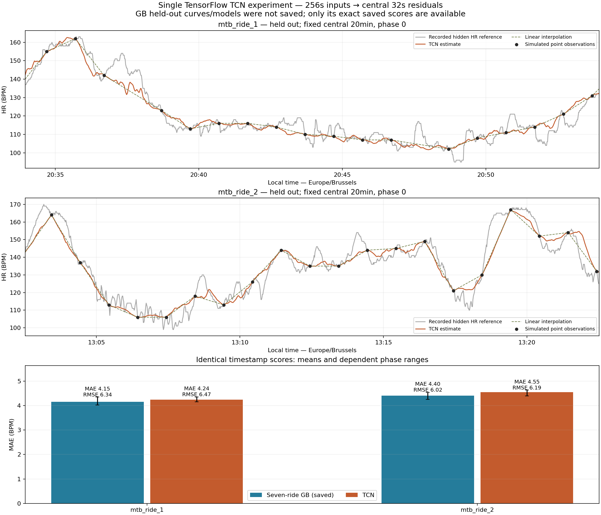
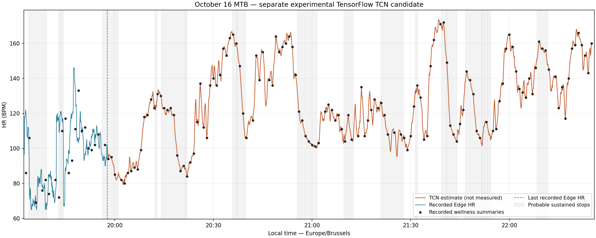

# Small TensorFlow TCN for HR reconstruction

**A. Retain the gradient-boosting seven-ride benchmark.**

Exactly three 30-epoch fits, seed 265: hold out MTB 1, hold out MTB 2, final all seven. No tuning, restart, early stopping, alternate architecture, GB refit or virtual data. The single untrained smoke test is not a training fit.

## Environment and implementation

```json
{
  "os": "Windows-10-10.0.26300-SP0",
  "python": "3.9.7 (default, Sep 16 2021, 16:59:28) [MSC v.1916 64 bit (AMD64)]",
  "executable": "C:\\ProgramData\\Anaconda3\\envs\\deep\\python.exe",
  "tensorflow": "2.6.1",
  "keras": "2.6.0",
  "devices": [
    "PhysicalDevice(name='/physical_device:GPU:0', device_type='GPU')"
  ],
  "gpu_details": [
    {
      "device_name": "NVIDIA GeForce RTX 3080 Laptop GPU",
      "compute_capability": [
        8,
        6
      ]
    }
  ],
  "operation_device": "/job:localhost/replica:0/task:0/device:GPU:0",
  "operation_sum": 262144.0,
  "sdk": "C:\\Projects\\Py\\git\\vtt_apero\\.venv\\Lib\\site-packages\\garmin_fit_sdk\\__init__.py",
  "numpy": "1.23.5",
  "pandas": "1.3.3",
  "tf_memory_bytes": {
    "current": 17920,
    "peak": 50688
  },
  "device_memory_inventory": "NVIDIA GeForce RTX 3080 Laptop GPU, 8192 MiB, 5953 MiB"
}
```

The Conda launcher requires execution outside the Codex sandbox on this host (inside it reports an illegal system DLL relocation); the experiment runs via `conda run --no-capture-output -n deep python`. No environment was created or modified. Deep lacks garmin-fit-sdk: reuse only the repository's existing pure-Python SDK package by file location, without adding the whole .venv to Python paths or loading its binary dependencies. If that local package is unavailable, the minimum standalone fix is `conda run -n deep python -m pip install garmin-fit-sdk==21.218.0`; it was not executed. TensorFlow/CUDA/cuDNN/Python were never reinstalled. [TensorFlow installation reference](https://www.tensorflow.org/install/pip).

One non-causal float32 network: input (256,28); 1×1 projection to 16 channels; five residual blocks with two kernel-3 same/stride-1 convolutions at dilations 1,2,4,8,16, ReLU and skip-add; final linear 1×1 residual projection and crop [112:144]. Output (32,1). Parameters: 8321. Effective receptive field = 1 + 2×(3−1)×(1+2+4+8+16) = **125s**, radius 62. The central outputs have sufficient margin in an unpadded 256s window. GPU gradient support independently confirms exact RF endpoints. TF32 and mixed precision are disabled.

Adam 0.001, masked Huber delta 5 BPM, batch 32, 30 epochs. Normalize loss by eligible central seconds; unsupported/missing-reference/declared-anchor targets have zero weight. No loss or reported output outside the central 32s. TensorFlow/Python/NumPy seeds are 265; deterministic-op and cuBLAS flags are set. GPU/library versions can still prevent bit-identical results; no repeated fit was run to claim deterministic training.

## Inputs, sampling and normalization

Numeric inputs: `baseline, sparse_hr, since_anchor_s, until_anchor_s, anchor_gap_s, speed5, speed_change10, stop_age_s, restart_age_s, climb_up, climb_down`. Finite-value flags for every numeric channel except sparse HR, whose anchor mask is explicit; binary channels: `anchor_mask, moving, stationary, movement_unknown, terrain_valid, record_valid, movement_valid`. Total **28 channels**, not flattened GB temporal summaries. Non-HR quantities reuse existing definitions. Sparse HR uses only declared point/averaged/actual wellness anchors. No power, cadence, ride ID or dense HR predictor. Means/scales fit exclusively on training rides' point-feature streams over the three phases, never held-out data. Missing normalized values are zero with validity=0; padded records have all channels zero and record_valid=0, so missing terrain is never presented as observed flat terrain.

Use exactly the actual ordered 142×60s + 15×120s watch interval sequence, cycling/truncating by elapsed UTC time; phases 0/20/40. Point anchors equal recorded HR; centered averages require all 60 recorded seconds [t−30,t+29], an unverified Garmin assumption used only as sensitivity. Train only point-anchor windows. Full 256s training windows lie inside continuous recorded blocks, stride **32s**, cyclically assigned to one phase (start/32 modulo 3); central output target spans do not overlap or duplicate seconds. This sequence-loss sampling is explicitly different from GB's five-second single-target selection. Boundary/short-block targets outside full training windows are not fabricated.

| Fit | Training rides | Windows | Eligible central seconds | Training s | First/last train loss |
|---|---|---|---|---|---|
| 1 | road_ride_1+road_ride_2+road_ride_3+road_ride_4+road_ride_5+mtb_ride_2 | 2632 | 83075 | 23.74 | 11.3202/7.6352 |
| 2 | road_ride_1+road_ride_2+road_ride_3+road_ride_4+road_ride_5+mtb_ride_1 | 2186 | 68965 | 19.95 | 10.8487/7.0658 |
| 3 | road_ride_1+road_ride_2+road_ride_3+road_ride_4+road_ride_5+mtb_ride_1+mtb_ride_2 | 2985 | 94248 | 27.69 | 11.4940/8.2824 |

| Fit | Source ride | Windows | Loss seconds |
|---|---|---|---|
| 1 | road_ride_1 | 425 | 13380 |
| 1 | road_ride_2 | 351 | 11076 |
| 1 | road_ride_3 | 459 | 14466 |
| 1 | road_ride_4 | 162 | 5113 |
| 1 | road_ride_5 | 436 | 13757 |
| 1 | mtb_ride_2 | 799 | 25283 |
| 2 | road_ride_1 | 425 | 13380 |
| 2 | road_ride_2 | 351 | 11076 |
| 2 | road_ride_3 | 459 | 14466 |
| 2 | road_ride_4 | 162 | 5113 |
| 2 | road_ride_5 | 436 | 13757 |
| 2 | mtb_ride_1 | 353 | 11173 |
| 3 | road_ride_1 | 425 | 13380 |
| 3 | road_ride_2 | 351 | 11076 |
| 3 | road_ride_3 | 459 | 14466 |
| 3 | road_ride_4 | 162 | 5113 |
| 3 | road_ride_5 | 436 | 13757 |
| 3 | mtb_ride_1 | 353 | 11173 |
| 3 | mtb_ride_2 | 799 | 25283 |

## Inference and comparable support

For each continuous recorded block, central starts are 0,16,32,… (fixed inference stride 16). Extract 256s around each central start, padding absent left/right context with masked zeros; clip each 32s output to this same block. Average overlaps per actual second. No input or averaging crosses a recording gap. Then, independently in every supported ≤180s anchor interval, apply the existing centered five-sample residual mean (min_periods=1) and multiply by 4f(1−f). Add to linear HR and restore anchors exactly, including isolated ones. Never extrapolate beyond baseline support. Altitude invalidity remains explicit even when neighboring non-HR context is usable.

TCN reconstruction support equals linear support exactly, including padded boundaries; common evaluation intersects point/averaged support with recorded reference HR and excludes both sets of anchor times. Every resulting UTC timestamp hash equals the saved seven-ride benchmark hash, with matching scored counts and reference-event counts. Hence no coverage loss or unavailable GB rescoring is hidden. One-second/phase observations remain correlated; only two MTB rides are independent holdouts.

**Plot limitation:** the existing repository saved GB scores and the target candidate, but no held-out prediction curves or fitted GB models. Drawing those curves would require an additional prohibited fit. The evaluation panels honestly show reference, sparse observations, TCN and interpolation; their bottom panel compares exact saved GB versus TCN scores. No GB curve is fabricated. The same predefined central 20min of the longest continuous HR block is used, phase 0, without inspecting errors.

## MTB validation

| Held out | Anchors | Phase | GB MAE/RMSE | TCN MAE/RMSE | TCN bias | Common n (%) |
|---|---|---|---|---|---|---|
| mtb_ride_1 | averaged | 0 | 3.896/5.519 | 4.090/5.724 | -0.218 | 11287 (97.71%) |
| mtb_ride_1 | averaged | 20 | 3.848/5.524 | 4.112/5.857 | -0.427 | 11228 (97.20%) |
| mtb_ride_1 | averaged | 40 | 3.950/5.660 | 4.047/5.814 | -0.461 | 11287 (97.71%) |
| mtb_ride_1 | point | 0 | 4.023/6.120 | 4.149/6.248 | +0.016 | 11287 (97.71%) |
| mtb_ride_1 | point | 20 | 4.073/6.179 | 4.222/6.440 | -0.652 | 11228 (97.20%) |
| mtb_ride_1 | point | 40 | 4.345/6.734 | 4.354/6.733 | -0.454 | 11287 (97.71%) |
| mtb_ride_2 | averaged | 0 | 4.097/5.354 | 4.363/5.777 | +0.380 | 25289 (97.98%) |
| mtb_ride_2 | averaged | 20 | 4.074/5.370 | 4.274/5.638 | +0.308 | 25289 (97.98%) |
| mtb_ride_2 | averaged | 40 | 4.053/5.436 | 4.202/5.584 | +0.327 | 25348 (98.21%) |
| mtb_ride_2 | point | 0 | 4.427/6.042 | 4.621/6.342 | +0.264 | 25289 (97.98%) |
| mtb_ride_2 | point | 20 | 4.540/6.126 | 4.629/6.261 | +0.500 | 25289 (97.98%) |
| mtb_ride_2 | point | 40 | 4.248/5.887 | 4.389/5.966 | +0.155 | 25348 (98.21%) |

| Ride | Anchors | Model | Mean MAE [phase range] | Mean RMSE [phase range] |
|---|---|---|---|---|
| mtb_ride_1 | averaged | TCN | 4.083 [4.047,4.112] | 5.798 [5.724,5.857] |
| mtb_ride_1 | averaged | linear | 4.151 [4.117,4.185] | 5.870 [5.842,5.884] |
| mtb_ride_1 | averaged | seven_ride | 3.898 [3.848,3.950] | 5.568 [5.519,5.660] |
| mtb_ride_1 | point | TCN | 4.241 [4.149,4.354] | 6.474 [6.248,6.733] |
| mtb_ride_1 | point | linear | 4.345 [4.262,4.498] | 6.655 [6.483,6.919] |
| mtb_ride_1 | point | seven_ride | 4.147 [4.023,4.345] | 6.344 [6.120,6.734] |
| mtb_ride_2 | averaged | TCN | 4.280 [4.202,4.363] | 5.667 [5.584,5.777] |
| mtb_ride_2 | averaged | linear | 4.093 [4.068,4.109] | 5.462 [5.407,5.570] |
| mtb_ride_2 | averaged | seven_ride | 4.075 [4.053,4.097] | 5.387 [5.354,5.436] |
| mtb_ride_2 | point | TCN | 4.546 [4.389,4.629] | 6.190 [5.966,6.342] |
| mtb_ride_2 | point | linear | 4.459 [4.326,4.551] | 6.127 [6.012,6.188] |
| mtb_ride_2 | point | seven_ride | 4.405 [4.248,4.540] | 6.018 [5.887,6.126] |

Established score-only masks and metrics are reused unchanged: upper-decile high HR; ≥5/≤−5 BPM over 30s for rise/recovery; ≥10 BPM-prominence reference peaks ≥120s apart. Peak errors use fully scored ±15s local maxima, so timing is bounded by that window. Unmatched predicted peaks lack reference peaks within ±30s. Step roughness uses consecutive supported seconds including anchors. Stationary and ≤30s restart errors require recorded reference HR. Full per-phase/scenario metrics and eligible event counts are in the CSV; NaN means unavailable, never zero error.

| Ride | Model | High MAE | Rise/recovery | Peak amp/timing | Stationary/restart | Unmatched mean | Step p99 mean/max | >5 BPM/s % max |
|---|---|---|---|---|---|---|---|---|
| mtb_ride_1 | TCN | 1.54 | 5.80/4.76 | 9.21/10.76 | 3.58/4.77 | 6.0 | 1.092/1.969 | 0.000 |
| mtb_ride_1 | linear | 1.73 | 5.88/5.10 | 10.76/15.00 | 3.50/4.66 | 6.3 | 0.683/0.817 | 0.000 |
| mtb_ride_1 | seven_ride | 1.50 | 5.83/4.53 | 10.28/11.50 | 3.46/4.53 | 5.3 | 0.953/2.018 | 0.000 |
| mtb_ride_2 | TCN | 4.47 | 5.05/5.28 | 7.07/11.34 | 4.33/4.80 | 27.3 | 1.021/1.975 | 0.000 |
| mtb_ride_2 | linear | 4.70 | 5.02/5.18 | 8.89/15.00 | 4.29/4.53 | 21.0 | 0.650/1.017 | 0.000 |
| mtb_ride_2 | seven_ride | 4.44 | 4.88/5.22 | 7.95/11.75 | 4.27/4.64 | 17.3 | 0.812/1.756 | 0.000 |

## October 16 secondary overlap and candidate

Frozen all-seven model, real watch anchors, existing movement/stopping variables and quality-masked Strava climb30. Overlap scoring uses only the 21 actual watch anchors inside the initial Edge recording; no withheld Edge value enters inputs. This repeatedly examined overlap is secondary and does not tune training. Real wellness summaries are pseudo-point constraints, not verified instantaneous HR.

| Model | MAE/RMSE | Bias | High MAE | Recovery MAE | Common n (%) |
|---|---|---|---|---|---|
| TCN | 12.568/16.642 | -0.359 | 21.20 | 14.26 | 1420 (93.11%) |
| linear | 12.976/17.390 | -1.081 | 25.36 | 14.64 | 1420 (93.11%) |
| seven_ride | 12.443/16.539 | -0.192 | 22.63 | 14.58 | 1420 (93.11%) |

The separate full candidate preserves every Edge value and all watch summaries in a separate column. After the recorded section, its last observed Edge value is only a forward handoff anchor, followed by subsequent watch anchors; that value never enters withheld-overlap prediction. Source/quality flags identify estimates, measurements and missing support.

| Mean BPM | Max BPM | Recorded/estimated seconds | Support n (%) | Missing seconds | Estimated step p99/max |
|---|---|---|---|---|---|
| 121.664 | 173.545 | 1525/8834 | 10359 (99.52%) | 50 | 1.023/1.632 |

## Artifacts, checks and decision





Script: `scripts/evaluate_hr_tcn_tensorflow.py`; metrics: `data/processed/hr_tcn_tensorflow_metrics.csv`; candidate: `data/processed/hr_tcn_tensorflow_candidate_2026-10-16.csv`. Final compact Keras model: `data/processed/hr_tcn_tensorflow_model.h5` (load with `compile=False`); normalization/features/environment/training histories: `data/processed/hr_tcn_tensorflow_normalization.json`. Prediction also requires this script's feature construction and postprocessing. No model file is committed.

Failure-safe per-fit models and matching normalization/data hashes are retained in `data/processed/hr_tcn_tensorflow_checkpoints/` (fit_1/2/3.h5 and JSON sidecars; each model is under 100KB). `--resume` reuses completed fits after checking source hashes and training membership, without another training call. The reported experiment completed normally with exactly three fits; checkpoints were used only for read-only reproduction checks.

```powershell
conda run --no-capture-output -n deep python scripts/evaluate_hr_tcn_tensorflow.py
```

- Physical GPU and actual float32 GPU matrix multiplication and TCN convolutions verified; no CPU fallback.
- One smoke test: input/output shapes, exact 125s gradient RF, central-32 alignment, padded-block extraction, overlap averaging and masked Huber values pass.
- Original point/complete-average anchors and deterministic UTC schedules reused; exact gap/window/stop/terrain checks pass; raw features exclude hidden HR and unsupported target labels are masked.
- mtb_ride_1: held-out exclusion, training-only normalization, hidden-HR feature substitution, exact benchmark timestamp hash/event counts, matching support and exact anchors pass.
- mtb_ride_2: held-out exclusion, training-only normalization, hidden-HR feature substitution, exact benchmark timestamp hash/event counts, matching support and exact anchors pass.
- mtb_edge: held-out exclusion, training-only normalization, hidden-HR feature substitution, exact benchmark timestamp hash/event counts, matching support and exact anchors pass.
- Candidate read back: every original Edge HR and all separate watch observations exact; future watch anchors exact, original support retained and unsupported trailing seconds missing.
- All 13 evaluated timestamp hashes and saved linear metrics reproduce benchmark support and scoring; no coverage loss, benchmark refit or invented GB trajectory.
- Final H5 reloads with compile=False and all weights match the final-fit checkpoint; reloaded fit 1 reproduces all six held-out phase/scenario metrics and timestamp hashes within 1e-8 with no fit calls.
- Both figures visually inspected; nonempty artifacts, 39 CSV rows, matching UTC support hashes, saved benchmark data and original observation/support columns independently checked.
- 190 prior source/report/data files retain identical SHA-256; the principal README figure and benchmark remain unchanged.
- Exactly three fits and one untrained input/model smoke test; actual outputs checked nonempty and figures inspected after generation. No separate suite or new dependency.

Recommendation screen fixed before fitting: require lower phase-mean point MAE and RMSE on both rides, no >0.5 BPM high/recovery/stationary/restart regression, no >1 BPM peak-amplitude or >2s timing regression, and no invalid HR or >5 BPM/s jumps. These are descriptive screens, not significance tests or population proof. Averaged sensitivity, event tradeoffs and the secondary overlap remain visible regardless of the decision. No settings are selected from these results.

Only two MTB references (different sensor paths/seasons), correlated phases/seconds, sparse and uncertainly averaged wellness anchors, optical/reference errors and uncertain short peaks limit inference. No target power/cadence; speed and terrain do not uniquely measure effort. Padding addresses support but cannot create observed boundary context. More detailed/smoother curves are not evidence of true missing physiology. GPU-level nondeterminism remains possible despite fixed seeds/flags. No additional architecture is attempted.

A. Retain the gradient-boosting seven-ride benchmark.
