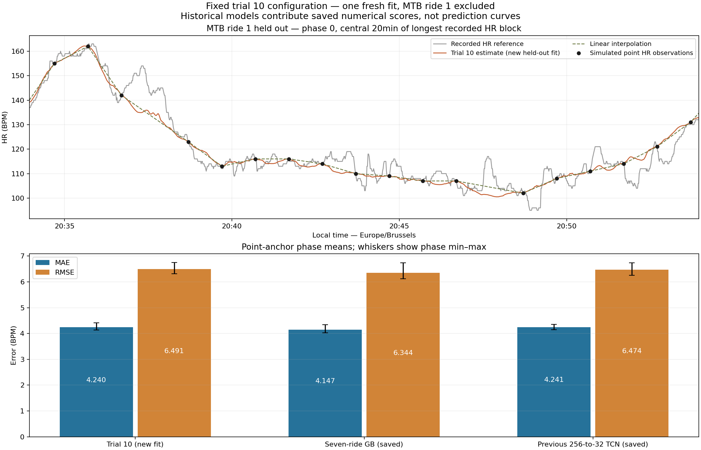

# Trial 10: additional held-out MTB ride 1 check

Exactly one new 30-epoch fit, freshly initialized at seed 265; no search, old-model refit, all-seven fit or October 16 reconstruction. Train: road rides 1–5 and MTB ride 2. MTB ride 1 is absent from normalization and training targets. The selected search checkpoint was never loaded; only this fit's new H5 is reloaded for verification.

## Fixed configuration and execution

128×28 inputs, central positions [56:72] → 16 residuals. 16 channels, kernel 3, two Conv1D layers per residual block, dilations 1/2/4/8, same padding, stride 1, ReLU/skip connections and linear projection. 6,753 parameters; RF = 1+4×15 = 61s. Every central output's actual GPU gradient support is checked: aggregate input positions 26–101, entirely inside 128. Adam 0.0003, batch 64, 30 epochs, seed 265, float32. Unchanged masked Huber(delta 5) + 0.5×10s HR-change MAE; both endpoints valid/unobserved.

Environment: Python 3.9.7; TensorFlow 2.6.1; Keras 2.6.0; executable `C:\ProgramData\Anaconda3\envs\deep\python.exe`; GPU [{'device_name': 'NVIDIA GeForce RTX 3080 Laptop GPU', 'compute_capability': (8, 6)}].

Training: 5823 windows, 91560 eligible seconds, 33752 temporal pairs; 24.72s. Final total/Huber/temporal losses: 10.39595 / 8.98659 / 2.81768.

| training_ride | windows | loss_seconds | temporal_pairs |
|---|---|---|---|
| road_ride_1 | 965 | 15141 | 5578 |
| road_ride_2 | 816 | 12808 | 4723 |
| road_ride_3 | 1064 | 16744 | 6175 |
| road_ride_4 | 430 | 6751 | 2481 |
| road_ride_5 | 942 | 14806 | 5447 |
| mtb_ride_2 | 1606 | 25310 | 9348 |


Reuse search training-window extraction at stride 16 with cyclic point phases 0/20/40; 128s windows never cross absent recorded seconds. Normalization uses only the six training rides. The exact October 16 sequence (142×60s + 15×120s) is replayed. Centered averages require all 60 observations and are an alternative assumption, not verified Garmin behavior. Inference uses stride 8 and averages overlapping central-16 predictions; boundary masks stay explicit. The centered five-sample residual mean, 4f(1−f) anchor taper, ≤180s support, exact anchors and no unsupported extrapolation remain unchanged. No dense hidden HR, power or cadence enters predictors.

## MTB 1 phase results

| condition | phase | model | mae | rmse | bias | n | coverage_percent | supported_n | supported_percent |
|---|---|---|---|---|---|---|---|---|---|
| averaged | 0 | TCN_256 | 4.0897 | 5.7242 | -0.218 | 11287 | 97.7145 | 11461 | 99.2208 |
| averaged | 20 | TCN_256 | 4.1125 | 5.8574 | -0.4269 | 11228 | 97.2037 | 11401 | 98.7014 |
| averaged | 40 | TCN_256 | 4.0471 | 5.8137 | -0.4609 | 11287 | 97.7145 | 11461 | 99.2208 |
| averaged | 0 | seven_ride | 3.8956 | 5.5188 | -0.6148 | 11287 | 97.7145 | 11461 | 99.2208 |
| averaged | 20 | seven_ride | 3.8475 | 5.5238 | -0.6637 | 11228 | 97.2037 | 11401 | 98.7014 |
| averaged | 40 | seven_ride | 3.9504 | 5.66 | -0.7542 | 11287 | 97.7145 | 11461 | 99.2208 |
| averaged | 0 | trial10 | 4.014 | 5.7439 | -0.3685 | 11287 | 97.7145 | 11461 | 99.2208 |
| averaged | 20 | trial10 | 4.0258 | 5.8152 | -0.4182 | 11228 | 97.2037 | 11401 | 98.7014 |
| averaged | 40 | trial10 | 4.0593 | 5.7926 | -0.5465 | 11287 | 97.7145 | 11461 | 99.2208 |
| point | 0 | TCN_256 | 4.1486 | 6.2483 | 0.0162 | 11287 | 97.7145 | 11521 | 99.7403 |
| point | 20 | TCN_256 | 4.2222 | 6.4399 | -0.6516 | 11228 | 97.2037 | 11521 | 99.7403 |
| point | 40 | TCN_256 | 4.3536 | 6.7327 | -0.4545 | 11287 | 97.7145 | 11461 | 99.2208 |
| point | 0 | seven_ride | 4.0226 | 6.1201 | -0.3293 | 11287 | 97.7145 | 11521 | 99.7403 |
| point | 20 | seven_ride | 4.0734 | 6.1787 | -0.8478 | 11228 | 97.2037 | 11521 | 99.7403 |
| point | 40 | seven_ride | 4.3454 | 6.7337 | -0.723 | 11287 | 97.7145 | 11461 | 99.2208 |
| point | 0 | trial10 | 4.1359 | 6.314 | -0.117 | 11287 | 97.7145 | 11521 | 99.7403 |
| point | 20 | trial10 | 4.1755 | 6.4063 | -0.6235 | 11228 | 97.2037 | 11521 | 99.7403 |
| point | 40 | trial10 | 4.4086 | 6.7515 | -0.5307 | 11287 | 97.7145 | 11461 | 99.2208 |


Evaluated coverage excludes missing reference HR and both conditions' anchor times; supported coverage includes retained anchors. All three models have identical UTC timestamp hashes, support and event counts for each phase/condition; no coverage loss. Phases/seconds are correlated, not independent trials.

Phase means:

| condition | model | mae | rmse | bias |
|---|---|---|---|---|
| averaged | TCN_256 | 4.0831 | 5.7984 | -0.3686 |
| averaged | seven_ride | 3.8978 | 5.5675 | -0.6776 |
| averaged | trial10 | 4.033 | 5.7839 | -0.4444 |
| point | TCN_256 | 4.2415 | 6.4736 | -0.3633 |
| point | seven_ride | 4.1471 | 6.3442 | -0.6334 |
| point | trial10 | 4.24 | 6.4906 | -0.4237 |


Dynamic metrics by phase (BPM except peak timing in seconds and unmatched counts):

| condition | phase | model | high_mae | rise_mae | recovery_mae | peak_amplitude_mae | peak_timing_mae_s | unmatched_peaks | stationary_mae | restart_mae |
|---|---|---|---|---|---|---|---|---|---|---|
| averaged | 0 | TCN_256 | 1.5897 | 5.6543 | 4.7 | 7.2774 | 9.8421 | 8 | 3.3305 | 4.6256 |
| averaged | 20 | TCN_256 | 1.5333 | 5.83 | 4.5282 | 9.4864 | 11.125 | 7 | 3.2501 | 4.5431 |
| averaged | 40 | TCN_256 | 1.8288 | 5.6901 | 4.5726 | 10.1616 | 9.8696 | 5 | 3.1954 | 4.6372 |
| averaged | 0 | seven_ride | 1.3984 | 5.774 | 4.2757 | 9.1609 | 13.0526 | 4 | 3.1431 | 4.2336 |
| averaged | 20 | seven_ride | 1.4215 | 5.6278 | 4.1797 | 10.5865 | 11.0 | 5 | 3.0839 | 4.0964 |
| averaged | 40 | seven_ride | 1.9032 | 5.7334 | 4.2582 | 10.3915 | 10.9565 | 5 | 3.0802 | 4.3693 |
| averaged | 0 | trial10 | 1.3845 | 5.8418 | 4.454 | 9.4071 | 12.3684 | 4 | 3.2117 | 4.3666 |
| averaged | 20 | trial10 | 1.3999 | 5.6947 | 4.5184 | 10.8633 | 11.2083 | 5 | 3.2226 | 4.3175 |
| averaged | 40 | trial10 | 1.7781 | 5.7876 | 4.5339 | 10.4549 | 11.4783 | 5 | 3.2211 | 4.5589 |
| point | 0 | TCN_256 | 1.2798 | 5.5838 | 4.7709 | 7.5268 | 11.0 | 7 | 3.4939 | 4.7545 |
| point | 20 | TCN_256 | 1.5767 | 6.0478 | 4.6288 | 9.8759 | 11.875 | 6 | 3.5086 | 4.3791 |
| point | 40 | TCN_256 | 1.7665 | 5.7774 | 4.8759 | 10.2316 | 9.3913 | 5 | 3.7261 | 5.1716 |
| point | 0 | seven_ride | 1.0943 | 5.7321 | 4.5049 | 9.5342 | 12.8421 | 8 | 3.3588 | 4.4007 |
| point | 20 | seven_ride | 1.4504 | 5.9265 | 4.3878 | 10.7471 | 11.0 | 4 | 3.4394 | 4.0974 |
| point | 40 | seven_ride | 1.9446 | 5.8416 | 4.6865 | 10.5505 | 10.6522 | 4 | 3.5941 | 5.0906 |
| point | 0 | trial10 | 1.1185 | 5.7394 | 4.6055 | 9.7797 | 12.4211 | 9 | 3.4701 | 4.5326 |
| point | 20 | trial10 | 1.5506 | 5.9872 | 4.6196 | 11.0285 | 12.0417 | 6 | 3.4938 | 4.2136 |
| point | 40 | trial10 | 1.7691 | 5.9491 | 4.8024 | 10.6566 | 11.0 | 4 | 3.7818 | 5.2362 |


Dynamic phase means:

| condition | model | high_mae | rise_mae | recovery_mae | peak_amplitude_mae | peak_timing_mae_s | unmatched_peaks | stationary_mae | restart_mae |
|---|---|---|---|---|---|---|---|---|---|
| averaged | TCN_256 | 1.6506 | 5.7248 | 4.6003 | 8.9751 | 10.2789 | 6.6667 | 3.2587 | 4.602 |
| averaged | seven_ride | 1.5744 | 5.7117 | 4.2378 | 10.0463 | 11.6697 | 4.6667 | 3.1024 | 4.2331 |
| averaged | trial10 | 1.5208 | 5.7747 | 4.5021 | 10.2418 | 11.685 | 4.6667 | 3.2185 | 4.4144 |
| point | TCN_256 | 1.541 | 5.803 | 4.7585 | 9.2115 | 10.7554 | 6.0 | 3.5762 | 4.7684 |
| point | seven_ride | 1.4965 | 5.8334 | 4.5264 | 10.2772 | 11.4981 | 5.3333 | 3.4641 | 4.5296 |
| point | trial10 | 1.4794 | 5.8919 | 4.6758 | 10.4883 | 11.8209 | 6.3333 | 3.5819 | 4.6608 |


Continuity/range by phase:

| condition | phase | model | step_p99 | max_step | steps_gt5_percent | invalid_hr_n | prediction_min | prediction_max |
|---|---|---|---|---|---|---|---|---|
| averaged | 0 | TCN_256 | 1.0033 | 1.9788 | 0.0 | 0 | 98.9078 | 190.3574 |
| averaged | 20 | TCN_256 | 1.0566 | 1.7125 | 0.0 | 0 | 97.2597 | 188.3008 |
| averaged | 40 | TCN_256 | 1.0252 | 1.966 | 0.0 | 0 | 97.2583 | 189.2987 |
| averaged | 0 | seven_ride | 0.8747 | 1.6509 | 0.0 | 0 | 100.3244 | 189.1898 |
| averaged | 20 | seven_ride | 0.8829 | 1.8288 | 0.0 | 0 | 100.9549 | 189.3471 |
| averaged | 40 | seven_ride | 0.818 | 1.5091 | 0.0 | 0 | 103.5541 | 189.2695 |
| averaged | 0 | trial10 | 0.765 | 1.1442 | 0.0 | 0 | 99.6599 | 189.2674 |
| averaged | 20 | trial10 | 0.7732 | 1.1725 | 0.0 | 0 | 99.7143 | 189.1407 |
| averaged | 40 | trial10 | 0.7534 | 1.1353 | 0.0 | 0 | 102.1356 | 188.4073 |
| point | 0 | TCN_256 | 1.0901 | 1.9672 | 0.0 | 0 | 97.3219 | 190.8666 |
| point | 20 | TCN_256 | 1.0955 | 1.7279 | 0.0 | 0 | 96.0 | 188.8229 |
| point | 40 | TCN_256 | 1.091 | 1.9694 | 0.0 | 0 | 96.2633 | 189.0 |
| point | 0 | seven_ride | 0.9778 | 1.6822 | 0.0 | 0 | 101.6687 | 189.6965 |
| point | 20 | seven_ride | 0.9719 | 2.0182 | 0.0 | 0 | 96.0 | 189.844 |
| point | 40 | seven_ride | 0.9106 | 1.8231 | 0.0 | 0 | 99.0 | 189.5705 |
| point | 0 | trial10 | 0.8473 | 1.2883 | 0.0 | 0 | 100.5126 | 189.8498 |
| point | 20 | trial10 | 0.8739 | 1.3551 | 0.0 | 0 | 96.0 | 189.61 |
| point | 40 | trial10 | 0.8556 | 1.2851 | 0.0 | 0 | 99.0 | 189.0 |


Metric definitions are unchanged: high HR is the reference upper decile; rise/recovery uses ±5 BPM over 30s; peaks require 10 BPM prominence and 120s separation. Peak amplitude/timing uses supported ±15s local maxima (bounded timing error); unmatched predicted peaks lack a reference peak within ±30s. Restart MAE covers ≤30s since restart; one-second changes use consecutive supported timestamps including anchors.

## Earlier MTB 2 selection result (saved, no new fit)

| model | mae | rmse | bias | high_mae | rise_mae | recovery_mae | peak_amplitude_mae | peak_timing_mae_s | unmatched_peaks | stationary_mae | restart_mae |
|---|---|---|---|---|---|---|---|---|---|---|---|
| TCN_256 | 4.5463 | 6.1896 | 0.3061 | 4.4744 | 5.0453 | 5.2814 | 7.0661 | 11.3427 | 27.3333 | 4.3287 | 4.7991 |
| seven_ride | 4.405 | 6.0182 | 0.2729 | 4.4407 | 4.8753 | 5.2207 | 7.9476 | 11.7532 | 17.3333 | 4.2727 | 4.6399 |
| trial10 | 4.3165 | 5.8952 | 0.0762 | 4.3079 | 4.9112 | 4.9616 | 7.8973 | 12.1366 | 18.3333 | 4.1441 | 4.5961 |


## Decision

1. Beats saved gradient boosting in MTB 1 point MAE and RMSE: **no**.
2. Beats the previous 256→32 TCN in both: **no**.
3. Peak/recovery/stationary practical screen relative to GB: **passes**. Reuse the previously documented tolerances: +0.5 BPM high/recovery/stationary/restart, +1 BPM peak amplitude, +2s peak timing, no >5 BPM/s steps or invalid HR. This is a descriptive screen, not validated scientific or clinical acceptability; rise and unmatched-peak counts remain visible separately.
4. MTB 1/MTB 2 both beat GB in point MAE/RMSE: **no; the ride-level accuracy result is mixed**. MTB 2 gains are selected tuning results, not a second untouched test.
5. Freeze trial 10 for a later explicitly authorized all-seven fit: **not supported by consistent accuracy and dynamic improvements; retain GB as principal benchmark**. No promotion or final fit is performed here.

MTB ride 2 was used for hyperparameter selection; MTB ride 1 has been examined in earlier development. This is an additional ride-level check, not a completely untouched independent test. Single-seed GPU nondeterminism, sensor errors, sparse/uncertainly averaged watch observations, absent power/cadence and uncertain short peaks limit interpretation. No settings were adjusted after observing these scores.

## Figure and checks



Segment rule fixed before fitting: phase 0, central 20 minutes of the longest continuous reference-HR block. Historical scores have no available held-out curves here; none are fabricated.

- TensorFlow GPU matmul and all-output convolution/RF gradients pass; input/output 128×28→16×1, 6,753 parameters.
- Fresh seeded weights restored after RF check; the search checkpoint was never loaded. Exactly one 30-epoch fit.
- Training windows and normalization use only five roads plus MTB 2; gap-isolated stride-16 targets and valid endpoint masks reused.
- mtb_ride_1: held-out exclusion, training-only normalization, hidden-HR feature substitution, exact benchmark timestamp hash/event counts, matching support and exact anchors pass.
- New H5 reload reproduces the complete phase-0 estimate; CSV read-back matches metrics, UTC hashes/support and both saved comparators.
- 289 previous files, including search models/results, original data and README, retain identical SHA-256.

New model: `data/processed/hr_tcn_trial10_validation_model.h5` (load compile=False). Normalization/configuration/history/environment/source hashes: `data/processed/hr_tcn_trial10_validation_normalization.json`. Metrics: `data/processed/hr_tcn_trial10_validation_metrics.csv`.

```powershell
conda run --no-capture-output -n deep python scripts/validate_hr_tcn_trial10.py
```

The script refuses an existing normalization/model/output path to prevent accidental additional fits or overwrites. This command ran once for this validation; subsequent artifact checks and model reloads do not train.
