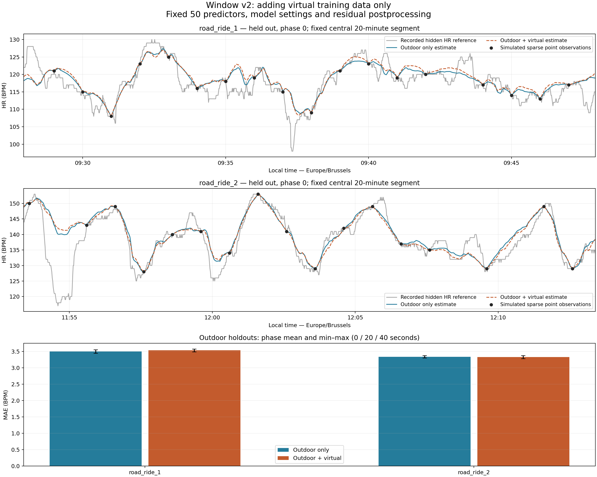

# Virtual training augmentation for Window v2

**Recommendation: C. Retain the outdoor-only model because the evidence is mixed.**

Only training membership changes. A uses the other outdoor ride; B adds all eligible MyWhoosh rows with equal per-example weight. No oversampling, weights, optional virtual validation, parameter search or promotion. The virtual ride trains B and is not an independent validation set. Existing v1 and Window v2 outputs remain intact; no new full-MTB reconstruction is generated.

## Data and provenance

Sources: `data/road_ride_1.fit`, `data/road_ride_2.fit`, `data/virtual_road_ride_1.fit`; target `data/mtb_edge.fit`, quality-masked `data/VTT_Apero.gpx` and `data/processed/watch_hr_ride_2026-10-16.csv`. FIT integrity/decoder checks run. UTC internally, Europe/Brussels below and in the figure.

The virtual FIT has MyWhoosh developer application ID `mywhoosh.whooshg` and a virtual-cycling session despite an Edge 840 product header; no device-info messages establish the optical sensor. FR265 optical HR over Bluetooth is rider-confirmed provenance, not inferred from that header. Power/cadence exist but never enter features. Virtual speed, distance, position and elevation describe the platform, not physical outdoor motion. Outdoor Edge metadata identifies ANT+ OHR without establishing physiological accuracy.

| Ride | Local start | Local end | HR rows | Span min | Gaps >1s | Training rows |
|---|---|---|---|---|---|---|
| road_ride_1 | 2026-10-04T09:20:00+02:00 | 2026-10-04T14:49:01+02:00 | 17735 | 329.02 | 20 | 2509 |
| road_ride_2 | 2026-09-26T09:49:36+02:00 | 2026-09-26T14:43:52+02:00 | 15455 | 294.27 | 22 | 2131 |
| virtual_road_ride_1 | 2026-10-12T16:27:52+02:00 | 2026-10-12T17:53:06+02:00 | 5115 | 85.23 | 0 | 780 |

| Outdoor training partition | A n | B n | Virtual % of B |
|---|---|---|---|
| road_ride_2 | 2131 | 2911 | 26.79 |
| road_ride_1 | 2509 | 3289 | 23.72 |
| road_ride_1 + road_ride_2 | 4640 | 5420 | 14.39 |

All per-ride training timestamps are unique; one sample every five elapsed seconds is assigned cyclically to exactly one phase, excluding that phase's anchors and unsupported baseline seconds. No virtual rows are replicated. HR residual targets use training HR only.

## Unchanged protocol and inputs

Replay the actual October 16 sequence (142×60s and 15×120s, 158 observations over 172min), cycling for longer rides and truncating shorter ones, at phases 0/20/40s. Point anchors equal the recorded value exactly. Averaged anchors require all 60 observed samples [t−30,t+29]; these are an alternative assumption, not established Garmin behavior. Both fits train on point anchors only. No anchor comes from missing HR. All gaps in reference recording split support; maximum anchor gap 180s; no extrapolation.

Keep exactly the same 50 ordered predictors: 20 anchor/movement/terrain plus 30 window summaries, including coverage/missingness. Four half-open regions [-60,-30), [-30,0), [0,30), [30,60); no hidden HR, identity, power, cadence or coordinates as predictors. Future non-HR measurements are permitted offline; existing centered terrain/speed preprocessing retains its own support. Incomplete means remain NaN and coverage remains explicit; HGB handles missing features. No smoothing, masks, feature definition or stopping rule was changed.

Fixed HistGradientBoostingRegressor parameters: `{'learning_rate': 0.05, 'max_iter': 120, 'max_leaf_nodes': 7, 'max_depth': 3, 'min_samples_leaf': 100, 'l2_regularization': 10.0, 'early_stopping': False, 'random_state': 265}`. Same linear residual baseline, centered five-sample residual smoothing and 4f(1−f) taper to preserve anchors. No model tuning, early stopping split or scaling. Python 3.8.8, scikit-learn 1.1.3.

| Ride | Phase s | Valid point anchors | Valid average anchors |
|---|---|---|---|
| road_ride_1 | 0 | 271 | 253 |
| road_ride_1 | 20 | 270 | 256 |
| road_ride_1 | 40 | 272 | 253 |
| road_ride_2 | 0 | 237 | 217 |
| road_ride_2 | 20 | 236 | 221 |
| road_ride_2 | 40 | 239 | 220 |
| virtual_road_ride_1 | 0 | 79 | 77 |
| virtual_road_ride_1 | 20 | 78 | 77 |
| virtual_road_ride_1 | 40 | 78 | 78 |

### Feature coverage and domain shift

Coverage below is on selected training rows. Complete windows means all four 30s record regions are present; complete window terrain means all four contain 30 valid climbing rates. A gap/stop can therefore reduce terrain support without discarding the training example.

| Ride | Complete record windows % | Complete terrain windows % | Current terrain valid % | Missing feature cells % |
|---|---|---|---|---|
| road_ride_1 | 94.38 | 90.55 | 99.36 | 3.25 |
| road_ride_2 | 94.09 | 89.30 | 99.72 | 3.30 |
| virtual_road_ride_1 | 98.85 | 89.49 | 96.28 | 3.53 |

| Ride | Speed5 p5/50/95 m/s | Climb30 p5/50/95 m/s | Stationary % | Moving >0.3m/s % | Full-record terrain valid % |
|---|---|---|---|---|---|
| road_ride_1 | 3.381/6.871/9.790 | -0.300/0.001/0.271 | 0.24 | 99.75 | 95.60 |
| road_ride_2 | 2.955/6.724/11.254 | -0.448/0.029/0.264 | 0.23 | 99.77 | 94.89 |
| virtual_road_ride_1 | 1.605/2.130/9.681 | -0.011/0.244/0.267 | 0.00 | 99.96 | 95.43 |

Existing preprocessing does not infer physical stops from virtual coordinates: its virtual stationary flag is zero by design, rather than a measured absence of physical rests. Platform terrain/speed relationships need not transfer to outdoor effort. Missing terrain and window coverage also differ by domain. These non-HR differences can alter fitted splits even without an explicit activity label. HR held values, optical error and different recording paths remain possible; 1Hz records are not independent physiological measurements.

## Outdoor results

A = outdoor only; B = outdoor + virtual. Errors in BPM, timing in seconds. All configurations AND both observation conditions use the same supported hidden timestamps within each ride/phase, excluding anchors in either condition. Bias equals average-HR error on these same seconds. Coverage denominator is all valid reference HR, not elapsed gaps. Phases are dependent simulations, not six independent rides.

| Held out | Anchors | Phase | A MAE/RMSE | B MAE/RMSE | B−A MAE | A/B bias | Common n (%) |
|---|---|---|---|---|---|---|---|
| road_ride_1 | averaged | 0 | 3.441/4.588 | 3.487/4.638 | +0.046 | +0.203/+0.266 | 14945 (84.27%) |
| road_ride_1 | averaged | 20 | 3.369/4.580 | 3.443/4.674 | +0.074 | +0.263/+0.321 | 15182 (85.60%) |
| road_ride_1 | averaged | 40 | 3.451/4.753 | 3.512/4.828 | +0.061 | +0.296/+0.378 | 15065 (84.95%) |
| road_ride_1 | point | 0 | 3.445/4.904 | 3.483/4.948 | +0.039 | +0.120/+0.172 | 14945 (84.27%) |
| road_ride_1 | point | 20 | 3.495/5.208 | 3.542/5.280 | +0.047 | +0.152/+0.224 | 15182 (85.60%) |
| road_ride_1 | point | 40 | 3.550/5.298 | 3.572/5.327 | +0.022 | +0.422/+0.527 | 15065 (84.95%) |
| road_ride_2 | averaged | 0 | 3.311/4.580 | 3.308/4.601 | -0.003 | +0.096/+0.002 | 12581 (81.40%) |
| road_ride_2 | averaged | 20 | 3.237/4.482 | 3.240/4.489 | +0.002 | -0.193/-0.275 | 12876 (83.31%) |
| road_ride_2 | averaged | 40 | 3.285/4.561 | 3.310/4.602 | +0.024 | -0.313/-0.408 | 12758 (82.55%) |
| road_ride_2 | point | 0 | 3.300/4.900 | 3.279/4.926 | -0.021 | +0.288/+0.204 | 12581 (81.40%) |
| road_ride_2 | point | 20 | 3.336/5.001 | 3.337/5.013 | +0.001 | +0.087/+0.005 | 12876 (83.31%) |
| road_ride_2 | point | 40 | 3.372/5.003 | 3.371/5.036 | -0.001 | -0.474/-0.545 | 12758 (82.55%) |

| Held out | Anchors | Model | Mean MAE [phase range] | Mean RMSE [phase range] | Mean bias |
|---|---|---|---|---|---|
| road_ride_1 | averaged | A | 3.420 [3.369, 3.451] | 4.640 [4.580, 4.753] | +0.254 |
| road_ride_1 | averaged | B | 3.481 [3.443, 3.512] | 4.714 [4.638, 4.828] | +0.322 |
| road_ride_1 | point | A | 3.497 [3.445, 3.550] | 5.137 [4.904, 5.298] | +0.231 |
| road_ride_1 | point | B | 3.532 [3.483, 3.572] | 5.185 [4.948, 5.327] | +0.308 |
| road_ride_2 | averaged | A | 3.278 [3.237, 3.311] | 4.541 [4.482, 4.580] | -0.137 |
| road_ride_2 | averaged | B | 3.286 [3.240, 3.310] | 4.564 [4.489, 4.602] | -0.227 |
| road_ride_2 | point | A | 3.336 [3.300, 3.372] | 4.968 [4.900, 5.003] | -0.033 |
| road_ride_2 | point | B | 3.329 [3.279, 3.371] | 4.992 [4.926, 5.036] | -0.112 |

road_ride_1: adding virtual training changes mean point MAE by +0.036 BPM and RMSE by +0.048 BPM. Under averaged anchors the changes are +0.060 and +0.073 BPM respectively.

road_ride_2: adding virtual training changes mean point MAE by -0.007 BPM and RMSE by +0.024 BPM. Under averaged anchors the changes are +0.008 and +0.023 BPM respectively.

Road 1 deteriorates in all three point phases; road 2 has a tiny mean MAE benefit but worse RMSE in every phase. Averaged anchors do not rescue the result: both rides' mean MAE and RMSE increase. The outdoor evidence does not support replacing Window v2.

### HR fluctuations, peaks and continuity

Existing score-only definitions: high HR = reference upper decile; rise/recovery = ≥5/≤−5 BPM change over 30s within a continuous block. True peaks have ≥10 BPM prominence and ≥120s separation. Peak amplitude/timing compare a local maximum within ±15s only where the entire 31s window is evaluated; timing is bounded by this window and is not unrestricted peak matching. Unmatched predicted peaks lack an observed peak within ±30s. Roughness uses consecutive supported seconds including anchors. Full phase/scenario metrics and subset counts are in the CSV.

| Ride | Model | High MAE | Rise/recovery MAE | Peak amp MAE/timing s | Unmatched peaks mean | Step p99 mean/max BPM/s | >5 BPM/s % max |
|---|---|---|---|---|---|---|---|
| road_ride_1 | A | 1.62 | 4.03/4.47 | 5.87/8.85 | 6.3 | 1.130/2.955 | 0.000 |
| road_ride_1 | B | 1.54 | 4.03/4.55 | 5.95/8.84 | 7.0 | 1.109/2.552 | 0.000 |
| road_ride_2 | A | 1.35 | 3.80/4.44 | 6.02/8.30 | 5.0 | 1.093/2.217 | 0.000 |
| road_ride_2 | B | 1.34 | 3.81/4.46 | 6.15/8.83 | 6.0 | 1.067/2.165 | 0.000 |

Point-anchor high-HR MAE improves slightly on both rides, but recovery MAE and peak-amplitude MAE worsen on both. Peak timing is nearly unchanged on road 1 and worse on road 2, with more unmatched peaks in phase means. Slightly lower step roughness therefore does not establish better fluctuation recovery. No estimate has a >5 BPM/s adjacent supported step or an invalid numeric HR range.

## Frozen pooled fits: target MTB overlap

A trains both roads, B trains both roads plus MyWhoosh. Apply actual watch anchors within the initial Edge overlap to identical movement/stopping and quality-masked Strava features. No Edge HR enters inputs, no handoff anchor is injected and no settings are tuned from this diagnostic. This overlap has been inspected repeatedly and is not a pristine independent test. Its sparse watch observations may differ from Edge instantaneous HR; this domain mismatch is absent from perfect synthetic point anchors.

| Model | MAE/RMSE | Bias | High MAE | Peak amp/timing | Stationary MAE | Restart ≤30s MAE | Scored n (%) | Step p99/max | Unmatched peaks |
|---|---|---|---|---|---|---|---|---|---|
| A | 12.499/16.667 | -0.888 | 21.99 | 14.14/11.80 | 11.86 (n=584) | 21.51 (n=178) | 1420 (93.11%) | 0.932/1.580 | 5 |
| B | 12.530/16.663 | -0.221 | 21.71 | 13.38/12.20 | 11.99 (n=584) | 21.37 (n=178) | 1420 (93.11%) | 0.928/1.693 | 4 |

MTB results are also mixed: B's MAE increases by 0.031 BPM while RMSE decreases by only 0.004 BPM. Bias, high-HR error, peak amplitude and restart error improve slightly; stationary error, recovery error (14.27→14.66 BPM) and peak timing worsen. Both configurations support 1,441 overlap timestamps including 21 anchors and score the same 1,420 hidden timestamps. This does not resolve the large watch/Edge disagreement.

### Full target support and continuity (unscored)

Also apply both frozen fits across the entire MTB timeline with all 158 real watch observations. This separate continuity diagnostic supplies no Edge HR or handoff anchor and never merges observations into a final reconstruction. It leaves the first 38s and final 50s unsupported. The overlap scores above retain the original benchmark's 21-anchor protocol; full-ride estimates are not scored or saved as a candidate.

| Model | Supported n (%) | HR min/max BPM | Step p99/max BPM/s | Supported stationary/restart n | >5 BPM/s % |
|---|---|---|---|---|---|
| A | 10321 (99.15%) | 69.00/172.00 | 1.003/1.797 | 3723/731 | 0.000 |
| B | 10321 (99.15%) | 69.00/172.00 | 0.972/1.930 | 3723/731 | 0.000 |

Stationary/restart counts describe available estimates, not their accuracy outside the recorded overlap. Real watch anchors remain exact; no unsupported boundary is filled. A continuous supported curve cannot establish recovery of unobserved physiological fluctuations.

## Decision and limitations

The following descriptive screen was fixed before fitting: require ≥0.1 BPM mean point MAE improvement on both roads, nonworsening point MAE/RMSE in every phase and both averaged-anchor means. Allow at most +0.5 BPM for high/rise/recovery, +1 BPM peak amplitude, +2s peak timing and +2 unmatched peaks in phase means. Require no >0.5 BPM MTB RMSE/high/stationary/restart regression, invalid HR or >5 BPM/s jumps. These are conservative practical checks, not significance tests; no weight/settings are selected against them. If both outdoor mean MAE and RMSE deteriorate choose A; otherwise an incomplete benefit yields C.

- FAIL: road_ride_1: mean MAE improvement >=0.1 BPM
- FAIL: road_ride_1: every point phase MAE/RMSE nonworsening
- FAIL: road_ride_1: averaged-anchor mean MAE/RMSE nonworsening
- PASS: road_ride_1: high_mae no material regression
- PASS: road_ride_1: rise_mae no material regression
- PASS: road_ride_1: recovery_mae no material regression
- PASS: road_ride_1: peak_amplitude_mae no material regression
- PASS: road_ride_1: peak_timing_mae_s no material regression
- PASS: road_ride_1: unmatched_peaks no material regression
- FAIL: road_ride_2: mean MAE improvement >=0.1 BPM
- FAIL: road_ride_2: every point phase MAE/RMSE nonworsening
- FAIL: road_ride_2: averaged-anchor mean MAE/RMSE nonworsening
- PASS: road_ride_2: high_mae no material regression
- PASS: road_ride_2: rise_mae no material regression
- PASS: road_ride_2: recovery_mae no material regression
- PASS: road_ride_2: peak_amplitude_mae no material regression
- PASS: road_ride_2: peak_timing_mae_s no material regression
- PASS: road_ride_2: unmatched_peaks no material regression
- PASS: MTB rmse no >0.5 BPM regression
- PASS: MTB high_mae no >0.5 BPM regression
- PASS: MTB stationary_mae no >0.5 BPM regression
- PASS: MTB restart_mae no >0.5 BPM regression
- PASS: No >5 BPM/s jumps or invalid numeric HR

Only two outdoor rides and one virtual training activity are available. Correlated seconds/phases do not establish population generalization or MTB physiological accuracy. Average bias can be small while rapid changes/peaks remain wrong. Missing power/cadence and technical MTB motion confound speed/terrain as effort proxies. Neither a smoother curve nor lower exploratory mean error establishes true second-by-second HR. Existing model status is unchanged; replacement needs explicit approval.

## Outputs and verification



Figure: phase-0 central 20min of the longest continuous HR block, identical to v2 selection, never selected by errors. Bottom panel shows mean and phase range, not a confidence interval.

Reproduce from repository root:

```powershell
.venv\Scripts\python.exe scripts/evaluate_hr_virtual_augmentation.py
```

Outputs: this report, `docs/images/hr_virtual_augmentation.png`, `data/processed/hr_virtual_augmentation_metrics.csv`; implementation `scripts/evaluate_hr_virtual_augmentation.py`.

- Virtual FIT integrity/decoding, MyWhoosh developer metadata, virtual session, 5,115 unique UTC 1Hz records verified; power/cadence excluded.
- Reused focused window checks pass: exact half-open bounds, future alignment, gap isolation, stop fractions and missing terrain coverage.
- Same 50 ordered columns and fixed settings; no HR/identity/power/cadence inputs; no duplicate training targets; exact point/complete averaged anchors and <=180s gap-isolated spans verified.
- road_ride_1: held out entirely; hidden-HR substitution leaves inputs/predictions identical; exact anchors, matching support, finite valid BPM
- road_ride_2: held out entirely; hidden-HR substitution leaves inputs/predictions identical; exact anchors, matching support, finite valid BPM
- Repeated first augmented fit produces bit-identical training predictions with fixed random state and two computation threads.
- mtb_edge: held out entirely; hidden-HR substitution leaves inputs/predictions identical; exact anchors, matching support, finite valid BPM
- Both frozen models applied to full MTB timeline: all 158 watch anchors exact, matching support, valid numeric HR and no extrapolation; Edge HR never supplied as an input. Full curves are unscored and not exported.
- All 13 saved Window v2 rows reproduce numeric metrics/support within 1e-10; matching timestamp scoring and bias/mean-HR identity verified.
- SHA-256 equality checked for all 174 pre-existing data/report/script files (excluding bytecode and this experiment's outputs); no original or prior output altered.
- Actual execution checks all three generated artifacts are non-empty. Figure readability is inspected after generation; no separate test suite or dependency added.

C. Retain the outdoor-only model because the evidence is mixed.
